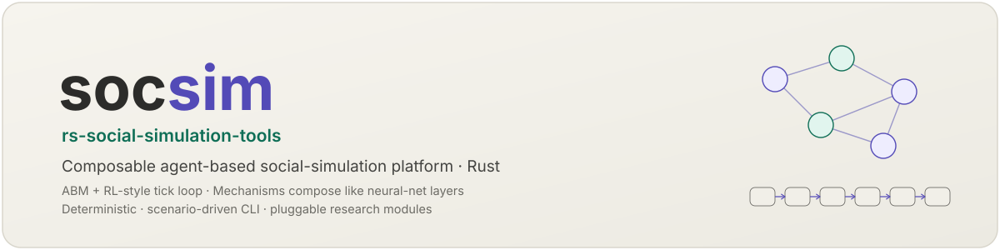
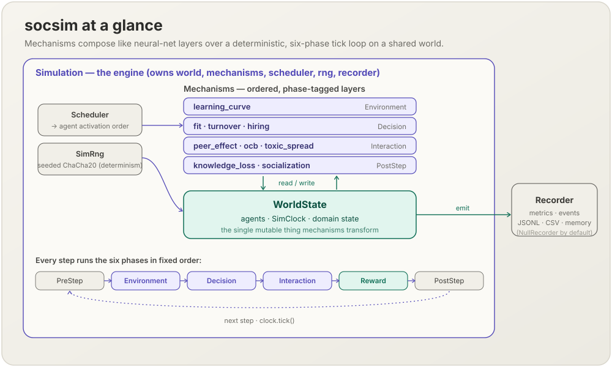

<p align="center"></p>

[English](README.md) | **日本語**

# rs-social-simulation-tools


`socsim` はRustで書かれた，コンポーザブルなエージェントベース社会シミュレーションプラットフォームです．トレイトベースのメカニズムシステム，シードされたChaCha20 RNGによる決定論的再現性，ソーシャルネットワーク層，空間グリッドのプリミティブ，保存・再開のためのWorld状態スナップショット，オプションの学習ポリシー（MARL），オプションのLLMエージェント層（Ollama/OpenAI，プロンプトキャッシュ付き），結果出力ヘルパ，再利用可能な観測メトリクスライブラリ，サーベイデータセットのスキーマと機械可読のデータセットレジストリ，戦略形ゲームの層（`socsim-games`：段階ゲーム，決定規則，対戦組み，利得，集団動学），そしてシナリオの実行・パラメータスイープ・集計のためのCLIを，19クレートのワークスペースとして提供します．CLIは **World 多態**です：シナリオは名前で *モジュールパック* を選択し，現在4つのパックを同梱しています — 文献に基づくキャリブレーションパラメータを持つ10メカニズムの参考実装 **HRライフサイクル** モジュール，ソーシャルネットワーク上で有界信頼コンセンサスモデルを実行する **opinion-dynamics** パック，階層的なネットワーク上で沈黙の風土の創発をモデル化し，LLM／ルールベースの voice 決定を切り替えられる **`organizational-silence`** パック，そしてシナリオファイルだけで組み立てた `socsim-games` のシミュレーション（繰り返しゲーム，空間ゲーム，寡占）を走らせる **`normal-form`** パックです．再利用可能でドメイン非依存なメカニズムは汎用の **`socsim-mechanisms`** カタログに収録され，意見ダイナミクス，ネットワーク伝播，文化伝播，グループダイナミクスの4つのフィーチャファミリにわたる8メカニズムを提供します．

## アーキテクチャ概要

<p align="center"></p>

`Simulation` エンジンは順序付き・フェーズタグ付きの `Mechanism` 層を駆動し，各層が共有 `WorldState` を読み書きします．`Scheduler` とシード化された `SimRng` を入力に取り，`Recorder` がメトリクスとイベントを出力します．6 フェーズのリボン（`PreStep → Environment → Decision → Interaction → Reward → PostStep`）は，各ステップでメカニズムが動作する固定順序です．クレート構成の実装ビューは [アーキテクチャページ](docs/architecture.ja.md)，抽象設計の理由は [設計ページ](docs/design.ja.md) を参照してください．

## インストール

ソースからビルド（Rustツールチェーンが必要）：

```sh
git clone https://github.com/akitenkrad/rs-social-simulation-tools.git
cd rs-social-simulation-tools
cargo build --release
```

バイナリは `target/release/socsim` に生成されます．

テストスイートの実行：

```sh
cargo test --workspace
```

## クイックスタート

```sh
socsim run scenarios/hr_lifecycle_baseline.toml
```

出力例：

```
Running 'hr_lifecycle_baseline' (pack=hr-lifecycle, t_max=60, seeds=[42], parallel=false)

Seed 42 — 82 events recorded

t             avg_tenure   knowledge_stock   org_performance     turnover_rate
10                9.1000           53.9517           32.1462            0.0000
20               14.6000           62.4468           35.7133            0.0000
30               21.5500           72.5042           40.4270            0.0250
40               25.9000           78.4727           40.2186            0.0000
50               30.0750           85.3493           40.8007            0.0000
60               35.6250           92.3841           41.8100            0.0000
```

`socsim` バイナリは World 多態です：シナリオは **モジュールパック**を名前で選択します（`socsim list packs`）．現在4つのパックを同梱しています — 補正済みの `hr-lifecycle` リファレンスモジュール，`socsim-mechanisms` の有界信頼メカニズムをソーシャルネットワーク上で実行する汎用 `opinion-dynamics` パック，階層的な組織で沈黙の風土の創発をモデル化する `organizational-silence` パック，そしてゲーム理論のモデルのための `normal-form` パックです：

```sh
socsim run scenarios/opinion_dynamics_baseline.toml
```

```
Running 'opinion_dynamics_baseline' (pack=opinion-dynamics, t_max=60, seeds=[42], parallel=false)

t               clusters         max_delta              mean            spread          variance
10               22.0000            0.1238            0.5092            0.9769            0.0360
30               15.0000            0.0127            0.5094            0.9769            0.0243
60               12.0000            0.0010            0.5098            0.9769            0.0232
```

有界信頼の意見は時間とともにより少ないクラスタへ収束します（コンセンサス）．`epsilon` を大きくすると完全な合意に至ります．

```sh
socsim run scenarios/org_silence_baseline.toml
```

```
Running 'org_silence_baseline' (pack=organizational-silence, t_max=60, seeds=[42], parallel=false)

t              silence_rate   climate_of_silence       voice_volume      org_performance
10                 0.5500               0.2750             0.2750              28.5630
30                 0.7250               0.4250             0.1500              22.4173
60                 0.6500               0.3500             0.2250              25.9982
```

沈黙の風土 C(t) は t=24 の salience ショックまで上昇し，その後，高い σ のもとでの voice が Argyris ダブルループ学習メカニズム経由でチームの `knowledge_stock` に流入することで，部分的に回復します．

```sh
socsim run scenarios/normal_form_cournot.toml
```

```
Running 'cournot_n3' (pack=normal-form, t_max=500, seeds=[7], parallel=false)

Seed 7 — 0 events recorded

t       game.action_sd.0  game.aggregate.price  game.aggregate.total_output  game.eq_distance  game.mean_action.0  game.mean_payoff    game.payoff_sd
10                1.2348           32.5000           67.5000            3.4739           22.5000          506.2500           27.7823
20                0.0695           32.5000           67.5000            0.1956           22.5000          506.2500            1.5645
...
50                0.0000           32.5000           67.5000            0.0000           22.5000          506.2500            0.0003
...
90                0.0000           32.5000           67.5000            0.0000           22.5000          506.2500            0.0000
```

減衰付き最適応答に従うクールノーの3社は，ナッシュ均衡の生産量 $q^* = 22.5$ に落ち着きます．`game_metrics` は生産量が動かなくなった時点で実行を止めます（500ステップのうち90ステップ）．ゲーム，集団，Matching，規則のパラメータはすべてシナリオファイルから読まれ，`socsim sweep` で `world.game.*` を直接変えられます（[normal-form パック](docs/packs/normal-form.ja.md)を参照）．

## ドキュメント

| ドキュメント | 内容 |
|---|---|
| [チュートリアル](docs/tutorials/index.ja.md) | **ここから始めてください．** 学習指向の，手を動かして進めるレッスン：CLI，最初のモデル，ネットワーク，グリッド，LLMエージェント，シナリオパック |
| [設計概要](docs/design.ja.md) | コンセプトと設計思想，主要トレイト/構造体，6フェーズ実行モデル |
| [CLIリファレンス](docs/cli.ja.md) | 全サブコマンド，フラグ，JSONL出力形式 |
| [ユースケース＆レシピ](docs/usecases.ja.md) | 代表的な研究ワークフローのランブック |
| [ライブラリAPI](docs/library.ja.md) | カスタムメカニズムの実装とライブラリとしての利用 |
| [Mechanismカタログ](docs/mechanisms.ja.md) | 全37メカニズム：理論，出典，図解，フェーズ上の位置付け，各メカニズムの適用方法 |
| [戦略形ゲーム](docs/games.ja.md) | `socsim-games`：段階ゲーム，決定規則，利得規則，実験状態，情報構造，格子とネットワーク上の集団動学，ゲームのソルバー，snapshot から正確に再開できるゲームのシミュレーション |
| [モジュールパック](docs/packs.ja.md) | 同梱の4つのパック（`hr-lifecycle`，`opinion-dynamics`，`organizational-silence`，`normal-form`）：World のデータモデル，メカニズムの構成，スターターシナリオ，記録されるメトリクス |
| [アーキテクチャ](docs/architecture.ja.md) | クレート依存グラフ，6フェーズティックループ，キャリブレーション哲学 |

## ライセンス

MIT — [LICENSE](LICENSE) を参照してください．
