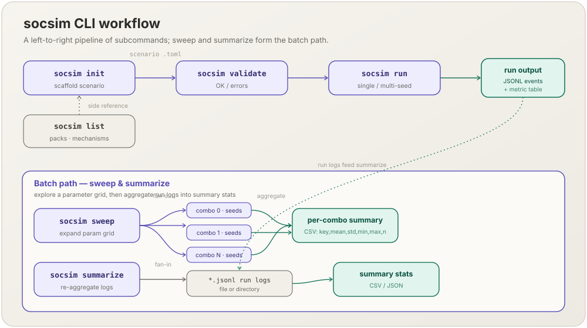

[English](cli.md) | **日本語**

# CLIリファレンス

`socsim` バイナリは6つのシナリオ系サブコマンドに加え，サーベイデータセット取得用の `datasets` グループを提供します．`socsim --help` または `socsim <COMMAND> --help` でフラグを確認できます．

このバイナリは **World 多態**です：すべてのシナリオは *モジュールパック* を名前で指定し，そのパックのWorld型へディスパッチされます．現在4つのパック（`hr-lifecycle`，`opinion-dynamics`，`organizational-silence`，`normal-form`）を同梱しており，新しいパックは `pack-*` Cargoフィーチャの背後に登録されます．

```
socsim <COMMAND>

Commands:
  init       Generate a starter scenario TOML for a module pack
  run        Run a scenario (single seed or multi-seed)
  validate   Validate a scenario TOML, then apply the selected pack's own checks
  list       List available module packs or mechanisms
  sweep      Run a grid parameter sweep
  summarize  Re-aggregate existing JSONL run logs into a summary
  datasets   List / show / fetch survey datasets from the registry
  help       Print this message or the help of the given subcommand(s)
```



---

## init

モジュールパック向けのスターターシナリオTOMLを生成します．

```
socsim init --module-pack <MODULE_PACK> --out <OUT>
```

| フラグ | 説明 |
|---|---|
| `--module-pack` | パック名（例：`hr-lifecycle`） |
| `-o, --out` | 出力ファイルパス |

**例**

```sh
socsim init --module-pack hr-lifecycle --out scenarios/my_scenario.toml
```

出力：

```
Wrote starter scenario to 'scenarios/my_scenario.toml'
```

どのパックにも雛形があります（例：`socsim init --module-pack opinion-dynamics --out scenarios/op.toml`，`socsim init --module-pack normal-form --out scenarios/ipd.toml`．後者は繰り返し囚人のジレンマで，`scenarios/normal_form_ipd.toml` と同じです）．

---

## run

シナリオTOMLを1つのシードまたは複数のシードで実行します．

```
socsim run [OPTIONS] <SCENARIO>
```

| フラグ | デフォルト | 説明 |
|---|---|---|
| `--seeds <A..B>` | シナリオのseed | シードの範囲（上限は排他） |
| `--parallel` | false | Rayonを使ったシードの並列実行 |

**単一シード実行**（TOMLに記載のシードを使用）：

```sh
socsim run scenarios/hr_lifecycle_baseline.toml
```

出力：

```
Running 'hr_lifecycle_baseline' (pack=hr-lifecycle, t_max=60, seeds=[42], parallel=false)

Seed 42 — 82 events recorded

t             avg_tenure   knowledge_stock   org_performance     turnover_rate
10                9.1000           53.9517           32.1462            0.0000
20               14.6000           62.4468           35.7133            0.0000
30               21.5500           72.5042           40.4270            0.0250
40               25.9000           78.4727           40.2186            0.0000
50               30.0750           85.3493           40.8007            0.0000
60               35.6250           92.3841           41.8100            0.0000
```

**マルチシード実行**では，ステップ系列の代わりにシード間サマリーテーブルが出力されます：

```sh
socsim run scenarios/hr_lifecycle_baseline.toml --seeds 0..3
```

出力：

```
Running 'hr_lifecycle_baseline' (pack=hr-lifecycle, t_max=60, seeds=[0, 1, 2], parallel=false)

Cross-seed summary (3 seeds):

metric                      mean         std         min         max      n
------------------------------------------------------------------------
avg_tenure               35.8000      0.5319     35.3750     36.5500      3
knowledge_stock          92.6772      1.2340     91.1426     94.1641      3
org_performance          42.8467      1.4574     40.7856     43.8800      3
turnover_rate             0.0083      0.0118      0.0000      0.0250      3
```

`run` は `Running …` を表示する前に，[`validate`](#validate) とまったく同じ検査を行います．無効なシナリオは終了コード1で止まり，何も実行も書き出しもしません．

各実行後，シナリオTOMLの `output.log_path` で指定されたJSONLログファイルが書き出されます（後述の[JSONL出力形式](#jsonl出力形式)を参照）．

---

## validate

シナリオTOMLを実行せずに検査します．

```
socsim validate <SCENARIO>
```

検査は2段からなり，この順に行います．

1. **汎用のシナリオ検査**（どのパックでも同じ）：すべての `[[mechanism]]` の名前が指定のパックに登録されていること，スケジューラーが既知（`"sequential"` か `"random_activation"`）であること，`t_max > 0` であること．
2. **パック固有の検査**（`CliPack::validate`）．`hr-lifecycle`，`opinion-dynamics`，`organizational-silence` のパックはここで何も足しません．`normal-form` パックはシナリオ全体を検査します．すべてのキーとその型，未知のキー，ゲーム・規則・Matching・集団動学の組合せ，シナリオの `seed` での1回の乾いた構築です（[normal-form パック § `validate` が拒否するもの](packs/normal-form.ja.md#validate-が拒否するもの)を参照）．

1段目が失敗すれば2段目は行いません．

**例**

```sh
socsim validate scenarios/hr_lifecycle_baseline.toml
# OK — scenario 'scenarios/hr_lifecycle_baseline.toml' is valid.
```

失敗するとファイル名と，その下に直すべきもの（`normal-form` パックではキーのパス）を表示します．

```
Error: validation failed for 'nowak_may.toml'

Caused by:
    config error: world.game.temptaton: unknown key (known keys: kind, punishment, reward, sucker, temptation)
```

```
Error: validation failed for 'ipd.toml'

Caused by:
    config error: mechanism 'game_decid' is not registered in the 'normal-form' pack; available: [fermi_update, game_decide, game_match, game_metrics, game_play, imitate_best, moran_update, replicator_update]
```

**`run` と `sweep` は先に検証します．** どちらのコマンドも，`Running …` / `Sweeping …` を表示する前，試行を走らせる前，ファイルを書く前に同じ2段の検査を行います．失敗すると終了コード1で終わり，JSONL ログも CSV もシナリオのファイルも残しません．`hr-lifecycle`，`opinion-dynamics`，`organizational-silence` のパックでは，有効なシナリオは以前とまったく同じに走ります．無効なシナリオは実行されずに拒否されるようになりました．たとえば `t_max = 0` のシナリオは以前は0ステップ走っていましたが，今は次のように止まります．

```
Error: validation failed for 'hr0.toml'

Caused by:
    config error: simulation.t_max must be > 0
```

---

## list

利用可能なモジュールパック，または各パック内のメカニズムを一覧表示します．各パックの内容については[モジュールパックカタログ](packs.ja.md)を参照してください．

```
socsim list <WHAT>
```

`<WHAT>` は `packs` または `mechanisms` のいずれかです．

**例**

```sh
socsim list packs
```

```
Available module packs:
  hr-lifecycle
  opinion-dynamics
  organizational-silence
  normal-form
```

```sh
socsim list mechanisms
```

```
Mechanisms by pack:
  [hr-lifecycle]
    fit
    hiring
    knowledge_loss
    learning_curve
    ocb
    org_performance
    peer_effect
    socialization
    toxic_spread
    turnover
  [opinion-dynamics]
    convergence
    deffuant
    hegselmann_krause
    lorenz
    opinion_metrics
    social_judgement
  [organizational-silence]
    climate_silence
    fear_appraisal
    issue_salience
    org_learning
    org_performance
    prefalse_cascade
    psafety_update
    retaliation_event
    silence_spiral
    voice_decision_rule
  [normal-form]
    fermi_update
    game_decide
    game_match
    game_metrics
    game_play
    imitate_best
    moran_update
    replicator_update
```

CLI を `--features pack-organizational-silence-llm` でビルドした場合，`[organizational-silence]` ブロックには `voice_decision_rule` の LLM 変種である `voice_decision` のエントリも追加で表示されます．

---

## sweep

1つ以上のパラメータ軸のデカルト積に対してグリッドパラメータスイープを実行します．

```
socsim sweep [OPTIONS] <SCENARIO>
```

| フラグ | デフォルト | 説明 |
|---|---|---|
| `--param <MECH.PARAM\|world.PATH=V1,V2,...>` | — | スイープ軸（多次元スイープは繰り返し指定）．`normal-form` パックでは `world.<PATH>=V1,V2,...` も書ける |
| `--seeds <A..B>` | `0..5` | 各組み合わせのシード範囲 |
| `-o, --out <DIR>` | `runs/sweep` | 組み合わせごとのCSVの出力ディレクトリ |
| `--parallel` | false | 各組み合わせ内のシードを並列実行 |

**例** — `toxic_spread.p_spread` が結果に与える影響を調査：

```sh
socsim sweep scenarios/hr_lifecycle_baseline.toml \
    --param "toxic_spread.p_spread=0.2,0.46,0.7" \
    --seeds 0..3
```

出力（抜粋）：

```
Sweeping 'hr_lifecycle_baseline' over 1 axes × 3 seeds
  toxic_spread.p_spread = [0.2, 0.46, 0.7]
  combo 0: toxic_spread.p_spread=0.2000
metric                      mean         std         min         max      n
------------------------------------------------------------------------
avg_tenure               35.3250      5.0624     29.1000     41.5000      3
...
  combo 2: toxic_spread.p_spread=0.7000
...
Wrote 3 CSV files to 'runs/sweep'
```

各CSVファイルは `combo_<N>_<param>=<value>.csv` という名前で，`key,mean,std,min,max,n` の列を持ちます．

**多次元スイープ** — 軸ごとに `--param` を追加：

```sh
socsim sweep scenarios/hr_lifecycle_baseline.toml \
    --param "peer_effect.alpha_peer=0.1,0.17,0.3" \
    --param "turnover.quit_cascade_bump=0.1,0.3,0.5" \
    --seeds 0..10 --parallel
```

`sweep` は [`validate`](#validate) と同じく，まず基準のシナリオを検査します．そのため基準のシナリオそのものが有効でなければなりません．`hr-lifecycle`，`opinion-dynamics`，`organizational-silence` のパックでは組合せを検査しません．存在しないキーの軸は黙って無視され，どの組合せも基準のパラメータで走ります．

```sh
socsim sweep scenarios/hr_lifecycle_baseline.toml --param "toxic_spread.p_sprea=0.2,0.5" --seeds 0..1
# exit 0; writes combo_0000_toxic_spread.p_sprea=0.2000.csv and combo_0001_…
```

綴りはメカニズムのページで確かめてください．

### 検証付きスイープ（`normal-form`）

`normal-form` パックは**検証付きスイープ**を行います．未知のパスはエラーになり，試行を1つも走らせる前にすべての組合せを検証し，組合せごとの実効シナリオを CSV の隣に書きます．

```sh
socsim sweep scenarios/normal_form_nowak_may.toml \
    --param "world.game.temptation=1.6,1.9" --seeds 0..2 -o runs/nm_sweep
```

```
Sweeping 'nowak_may_b185' over 1 axes × 2 seeds
  world.game.temptation = [1.6, 1.9]
  combo 0: world.game.temptation=1.6000
metric                      mean         std         min         max      n
------------------------------------------------------------------------
game.action_entropy       0.6787      0.0054      0.6733      0.6841      2
game.coop_rate            0.5832      0.0162      0.5670      0.5994      2
game.mean_payoff          5.9735      0.1399      5.8337      6.1134      2
...
  combo 1: world.game.temptation=1.9000
metric                      mean         std         min         max      n
------------------------------------------------------------------------
game.action_entropy       0.6114      0.0139      0.5975      0.6253      2
game.coop_rate            0.3014      0.0165      0.2849      0.3179      2
game.mean_payoff          3.4352      0.1473      3.2879      3.5825      2
...

Wrote 2 CSV files to 'runs/nm_sweep'
```

```
runs/nm_sweep/
  combo_0000_world.game.temptation=1.6000.csv
  combo_0000_world.game.temptation=1.6000.scenario.toml
  combo_0001_world.game.temptation=1.9000.csv
  combo_0001_world.game.temptation=1.9000.scenario.toml
```

**軸．** 軸は `world.` のパス（`[world]` の下に既にあるキーで，入れ子のテーブルをたどれる．`world.game.temptation`，`world.population.initial_shares.C`，`world.history_len`）か，`<mechanism>.<param>`（`game_decide.logit_lambda`，`fermi_update.k` など．その名前を持つすべての `[[mechanism]]` の項目を書き換える）です．スイープできるのは整数と浮動小数だけです．スイープする価値のある軸はパックのページの[一覧](packs/normal-form.ja.md#スイープ)にあります．

**実効シナリオ．** 各 `combo_<N>_<label>.scenario.toml` は，基準のシナリオにその組合せの値を書き込んだもので，`toml::to_string` で書かれます（コメントは消え，キーは整列されます）．完全なシナリオなので，これに `socsim run` をかけるとその組合せを再実行できます．ラベルは小数4桁で表示されるので，正確な値はこのファイルで読んでください（`stop_tol=1e-6` と `1e-9` はどちらも `0.0000` と表示されます．名前は組合せの番号で区別されます）．このファイルを書くのは `normal-form` パックだけです．

**エラー．** 誤った軸は，試行を走らせる前，出力ディレクトリを作る前にスイープを止めます（終了コード1）．

```
Error: sweep failed

Caused by:
    config error: sweep axis 'world.game.temptaton': no key 'temptaton' in [world.game]
```

| 原因 | 文言（`config error: ` の後） |
|---|---|
| `world.` のパスの綴り間違い | `sweep axis 'world.game.temptaton': no key 'temptaton' in [world.game]` |
| 未知のメカニズム名 | `sweep axis 'game_decid.logit_lambda': mechanism 'game_decid' is not in the scenario` |
| 対象が数値でない | `sweep axis 'world.game.kind': existing value is a string; only integer and float values can be swept` |
| 整数のキーに小数の値 | `sweep axis 'world.game.temptation': existing value is an integer; 1.6 is not an integral value representable as i64` |
| 基準のシナリオが省いた構成比のラベル | `sweep axis 'world.population.initial_shares.D': no key 'D' in [world.population.initial_shares]` |
| 有効なシナリオにならない組合せ | `sweep combination [world.game.temptation=0.9]: config error: world.game: catalog condition failed: T > R > P >= S` |
| メカニズムのパラメータの綴り間違い | `sweep combination [game_decide.logit_lamda=1]: config error: mechanism[game_decide].logit_lamda: unknown key (known keys: …)` |

**知っておくべき3つのこと．**

1. **整数は整数のままです．** `temptation = 2` と書いたキーは整数値でしかスイープできません．スイープする値は浮動小数で書いてください（`temptation = 2.0`）．
2. **`world.population.initial_shares.<label>` は基準のシナリオに書いたラベルだけをスイープできます．** 残りを受け取るために省いたラベルには，書き換えるキーがありません．
3. **メカニズムのパラメータが無ければ，拒否されずに浮動小数として足されます．** 割り当てた規則が読まないパラメータ（`scenarios/normal_form_ipd.toml` の `game_decide.logit_lambda`．`logit` に従うエージェントはいない）をスイープしても検査は通り，どの値でも結果は同じです．

---

## summarize

シミュレーションを再実行せずに，既存のJSONLログファイルをサマリー統計に集計し直します．

```
socsim summarize [OPTIONS] <PATH>
```

| フラグ | デフォルト | 説明 |
|---|---|---|
| `--format <csv\|json>` | `csv` | 出力形式 |

`<PATH>` は単一の `.jsonl` ファイルまたはディレクトリです．ディレクトリの場合は `*.jsonl` ファイルを非再帰的にスキャンします．

**例**

```sh
socsim summarize runs/hr_lifecycle_baseline_42.jsonl
```

```
key,mean,std,min,max,n
avg_tenure,35.625000,0.000000,35.625000,35.625000,1
knowledge_stock,92.384145,0.000000,92.384145,92.384145,1
org_performance,41.810021,0.000000,41.810021,41.810021,1
turnover_rate,0.000000,0.000000,0.000000,0.000000,1
```

```sh
socsim summarize runs/ --format json
```

---

## datasets

サーベイ replication を支えるサーベイデータセットを，`socsim-datasets` の機械可読レジストリから検査・取得します．このサブコマンドグループは World 多態のシナリオ系統とは**独立**しており，モジュールパックを必要としません．

```
socsim datasets <SUBCOMMAND>
```

| サブコマンド | 説明 |
|---|---|
| `datasets list` | レジストリ内の全データセットを一覧表示：キー，名称，ファイル数，取得方式（`auto` / `manual`） |
| `datasets show <KEY>` | 1つのデータセットの概要（名称，キー，DOI，ソース URL，引用，ライセンス）と，ファイルごとの取得方法を表示 —— **manual** ファイルは手順 URL ＋ 手順を，**自動ダウンロード可能**なファイルは解決済みのダウンロード URL，厳密な `socsim datasets fetch …` コマンド，および存在すれば `sha256` / `expect_rows` を表示 |
| `datasets fetch <KEY> [--dest <DIR>] [--force]` | データセットのファイルを `--dest`（デフォルトは gitignore された `data/` ディレクトリ）へ実際にダウンロードし，アトミックに書き込んで `sha256` ＋ 行数を検証し，キャッシュヒットはスキップ |

`fetch` は CLI をオプトインの **`--features datasets-acquire`** フラグ付きでビルドする必要があります．デフォルトの CLI ビルドでも `list` / `show` は動作しますが，`fetch` はそのフィーチャ付きで再ビルドするよう促すだけです．データはリポジトリに**決して同梱されず**，ライセンス制約のある生の ANES Time Series マイクロデータは `Source::Manual` として宣言され，自動ダウンロードの代わりに手動手順を提示します．一方，CC0 1.0（パブリックドメイン）の CES 2022 Common Content は `Source::Dataverse` として宣言され，自動ダウンロード可能です（`fetch ces-2022` が Harvard Dataverse から直接取得，アカウントや規約同意は不要）．

**例**

```sh
socsim datasets list
socsim datasets show anes-2020
cargo run --features datasets-acquire -- datasets fetch anes-2020 --dest data/
```

---

## JSONL出力形式

各 `socsim run` はシードごとに1つのJSONLファイルを書き出します．パスはシナリオTOMLの `output.log_path` で制御され，2つの置換トークンをサポートします：

| トークン | 置換内容 |
|---|---|
| `{name}` | `simulation.name` |
| `{seed}` | そのトライアルの整数シード値 |

テンプレート例：`"runs/{name}_{seed}.jsonl"` → `runs/hr_lifecycle_baseline_42.jsonl`

JSONLファイルの各行は独立したJSONオブジェクトです．2種類のレコードが出力されます：

**メトリクスレコード**

```json
{"type":"metric","t":1,"key":"turnover_rate","value":0.0}
```

**イベントレコード**

```json
{"type":"event","t":3,"kind":"turnover","payload":{"agent":7,"team":2}}
```

各タイプのフィールドは全レコードで統一されており，`payload` はメカニズム固有の内容になります．
