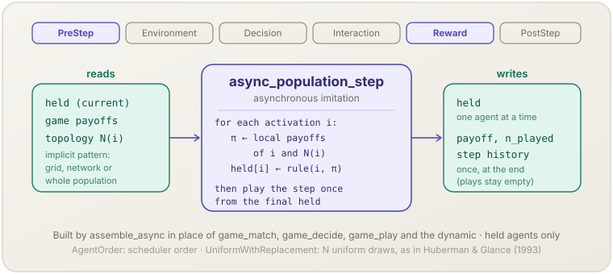

**English** | [日本語](async-population-step.ja.md)

# Asynchronous population step (`async_population_step`)

> Held agents update one at a time: each activated agent recomputes the payoffs it compares, applies an imitation rule and writes its new action at once, so the next agent already plays against it.
> **Phase:** PreStep, Reward. **Source:** Huberman & Glance (1993). **Kind:** asynchronous imitation.

[← Back to the mechanism catalog](../mechanisms.md)

## 1. Overview

`async_population_step` is the asynchronous form of the population dynamics of
[`socsim-games`](../games.md#asynchronous-update). It is registered by
`assemble_async`, and by `GameSimFactory` after `.async_dynamics(..)`, as the
**only** game mechanism of the simulation: it replaces `game_match`,
`game_decide`, `game_play` and the synchronous dynamic. It works on a world
whose agents are all **held** and whose matching evaluates encounters without
materialising them (`GridNeighborhood`, `NetworkEdges` or `WholePopulation`).
The copying rule is that of [`imitate_best`](imitate-best.md),
[`fermi_update`](fermi-update.md) or
[`replicator_update`](replicator-update.md), wrapped in an
`AsyncPopulationStep`. In every step it

1. activates $N$ agents one at a time, in the scheduler's order or by uniform
   draws with replacement (`AsyncActivation`);
2. for each activated agent $i$, recomputes from the current `held` the
   payoffs of $i$ and of the neighbours whose payoffs the rule compares, applies
   the rule, and writes $i$'s new action to `held` immediately;
3. after the last activation, plays the whole step once from the final `held`
   and records payoffs, play counts and the step history.

## 2. Theory & source

Nowak & May (1992) update every cell of the spatial prisoner's dilemma at the
same instant and obtain persistent, chaotically shifting clusters of
cooperators. Huberman & Glance (1993) argue that simultaneous updating needs a
global clock that real populations lack. They replace it by a sequence of
micro-steps: at each one a single randomly chosen cell updates, comparing
payoffs computed from the current configuration, and a generation consists of
$N$ micro-steps, so that on average each cell updates once per generation.
Starting from a single defector on a lattice of cooperators, the synchronous
model keeps a symmetric pattern with many cooperators, while the asynchronous
one ends in all defection (their Fig. 1).

For the activated agent $i$, with $\mathbf a$ the current held actions, the
rule reads the local payoffs

$$\pi_k(\mathbf a) = \bigoplus_{e \ni k} u_k\big(\mathbf a_e\big), \qquad k \in \{i\} \cup N(i)$$

- $e$ — the encounters in which $k$ is credited (its grid encounters as the
  centre, its incident network edges, or the single whole-population
  encounter);
- $u_k$ — $k$'s payoff in the encounter, from the game's payoff function;
- $\bigoplus$ — the sum, or the mean under `PayoffAggregation::Mean`;
- $N(i)$ — $i$'s topology neighbours (every agent under `WholePopulation`).

It then sets $a_i \leftarrow a_{\text{source}}$ by the dynamic's rule (best
earner, Fermi probability or proportional imitation) and writes it before the
next activation. The local payoffs are summed over the same encounters, in the
same order and with the same seat orientation as a full evaluation of the
step, so they equal the full recomputation bit for bit, and the ties of
`imitate_best` resolve exactly as they would there.

## 3. Data flow



Reads the held actions, the game's payoffs and the topology's neighbour lists.
Writes `held` one agent at a time and, once per step, the payoffs, play counts
and step history recomputed from the final actions.

## 4. Position in the 6-phase loop

Registers **PreStep** and **Reward**. In PreStep it clears the step's play
state as `game_match` does: the play arena is emptied and `payoff`,
`n_played` and the per-step played-action counts are reset, so a mechanism you
add in Decision or Interaction reads zero payoffs, as in a synchronous
simulation. In Reward it runs the activations and records the step. It does not
take part in Decision or Interaction. At PostStep, `payoffs()`, `n_played()`,
the step history and `held()` all describe the actions held after every update
of the step (see [What `PostStep` sees](../games.md#what-poststep-sees)).

## 5. State read/write contract

| Field | Read | Write | Notes |
|---|:--:|:--:|---|
| `GameWorld.held` | ✓ | ✓ | Written in place, one activated agent at a time. |
| `GameWorld.topology` | ✓ | | Neighbours whose payoffs the rule compares; on a directed network, the out-neighbours. |
| `GameWorld.payoff`, `n_played` | | ✓ | Zeroed in PreStep; written once at the end of Reward from the final `held`. The local payoffs live in the mechanism's scratch space, never in the world. |
| `GameWorld.plays` | | ✓ | Cleared in PreStep and left empty. |
| step history | | ✓ | One record per step, from the final `held`. |
| aggregate table | | ✓ | One row per step when the play path has aggregates. |
| `PolicyTable.slot` | ✓ | | Checked once at assembly: every agent must be held. |

The step's record has the same values that `game_play`'s implicit path would
write for the same `held`; it differs from the synchronous record in meaning,
not in form.

## 6. Dependencies & ordering constraints

- **Assembly:** `assemble_async(world, matching, play, step, opts, seed)`
  registers this mechanism alone. Do not add `game_match`, `game_decide`,
  `game_play` or another dynamic; the scheduler, the recorder and
  `game_metrics` are added by you.
- **Matching:** `GridNeighborhood`, `NetworkEdges` or `WholePopulation`;
  matchings that change partners every step (`RandomPairs`, `RandomGroups`)
  and matchings without an implicit pattern are rejected.
- **Play path:** `Pairwise::new(NormalFormOutcome)` or `counting_play()`, with
  or without aggregates; a user-defined `OutcomeRule` is rejected.
- **Options:** `DecisionScope::PerStep`, `materialize(false)`,
  `report_mixed(false)` and `OnInvalidAction::Stop` are required.
- **Dynamic:** constructed with `Update::Asynchronous`, and subject to the same
  checks as under `assemble_with` (held agents, a common action space, a grid
  or network for `imitate_best`, $\beta \le 1/\Delta\pi$ for
  `replicator_update`). `MoranUpdate` cannot be wrapped: a Moran step is one
  birth–death event drawn from everyone's fitness and has no "new action of
  the activated agent".
- **Downstream:** [`game_metrics`](game-metrics.md) runs in PostStep on the
  recomputed record; build it with
  `MetricsOptions::payoff_timing(PayoffTiming::AfterUpdate)` so that
  `describe()` states that meaning.

## 7. Parameters

| Parameter | Default | Kind | Notes |
|---|---|---|---|
| `AsyncPopulationStep::new(dynamics)` | — (required) | structural | `ImitateBest`, `FermiUpdate` or `ProportionalImitation`, constructed with `Update::Asynchronous`; their own parameters (tie-break, $K$, $\beta$) apply unchanged. |
| `activation(AsyncActivation)` | `AgentOrder` | structural | `AgentOrder`: every agent once, in the scheduler's order (ascending `AgentId` under the sequential scheduler, a new permutation every step under `RandomActivationScheduler`). `UniformWithReplacement`: $N$ uniform draws with replacement, ignoring the scheduler — the procedure of Huberman & Glance (1993). Read back with `activation_mode()`. |
| `log_updates(bool)` | `false` | observation | Records the event `game.async_update` with the payload `{"agent", "order", "from", "to"}` for each activation that changed the agent's action (`order` is the activation index in the step, from 0). Read back with `updates_logged()`. |

## 8. How to apply

Library-only. Scenario files and the `normal-form` pack do not accept the
asynchronous update.

### Library mode

```rust
use socsim_engine::SequentialScheduler;
use socsim_games::{
    assemble_async, AsyncActivation, AsyncPopulationStep, GridBoundary, GridNeighborhood,
    GridNeighbors, GridSpec, ImitateBest, ImitationTie, NormalFormOutcome, Pairwise, PlayOptions,
    Topology, Update,
};

let world = build_world(game, side * side, (), initial, &rules, &held, 1, steps, seed)?
    .with_topology(Topology::grid(GridSpec {
        rows: side,
        cols: side,
        boundary: GridBoundary::Fixed,
        neighborhood: GridNeighbors::Moore,
    })?)?;
let mut sim = assemble_async(
    world,
    GridNeighborhood::new().include_self(true),
    Pairwise::new(NormalFormOutcome),
    AsyncPopulationStep::new(
        ImitateBest::new(Update::Asynchronous).tie_break(ImitationTie::KeepOwn),
    )
    .activation(AsyncActivation::UniformWithReplacement),
    PlayOptions::new(),
    seed,
)?
.scheduler(Box::new(SequentialScheduler)) // the order is not used by UniformWithReplacement
.build();
```

With `GameSimFactory`, pass the same step to `.async_dynamics(..)`; the factory
then also sets `PayoffTiming::AfterUpdate` on its metrics (see
[Building with `GameSimFactory`](../games.md#type-state)). The complete
program is `crates/socsim-games/examples/huberman_glance.rs`
(`--features core,engine,grid`).

## 9. Determinism & RNG

Draws from the engine stream (`derive_seed(seed, &[1])`) in Reward, one
activation after another. Under `UniformWithReplacement` each activation draws
the agent (`gen_range(0..N)`) and then the rule's values — one partner and one
uniform `f64` for `fermi_update` and `replicator_update` (none for an agent
without neighbours), nothing for `imitate_best`; the $N$ agents are never drawn
in advance. Under `AgentOrder` it draws only the rule's values and uses the
order the scheduler drew. The scratch payoffs are recomputed at every
activation, so the mechanism keeps no state between steps and a snapshot
resumes it exactly. The same seed gives the same run.

## 10. Expected behaviour

Example `huberman_glance`: a 99 × 99 lattice with fixed boundaries, Moore
neighbours and self-play, `PrisonersDilemma::weak(1.85)`, one defector in the
centre, `ImitateBest` with `KeepOwn` and `UniformWithReplacement`:

```sh
cargo run -q -p socsim-games --features core,engine,grid --example huberman_glance -- --update async --steps 217 --seed 1
```

```text
generation,cooperator_share
1,0.9969390878481788
2,0.987756351392715
3,0.9732680338740944
...
119,0.00010203040506070809
120,0
...
217,0
```

- With seeds 0 to 4 every agent defects from generations 119, 120, 79, 129
  and 134 on; the same configuration under the synchronous `imitate_best`
  (`--update sync`) still has 3 920 cooperators (share 0.39995918783797574)
  at generation 217.
- **This result is limited to $b > 1.8$.** At or below $b = 1.8$, cooperation
  persists even under the asynchronous update.
- `AgentOrder` with the sequential scheduler is a deterministic sweep in
  `AgentId` order: from the symmetric single-defector start it breaks the
  lattice's symmetry within the first generation (after it, row 48 holds
  cooperators in columns 0–47 and defectors in columns 48–98), which the
  synchronous update preserves.
- Every agent holds the same number of seats under `WholePopulation`, on a
  torus or on a regular network; there `game.played_share` and
  `game.population_share` are equal at every step, because both are counted
  from the final `held`. On a lattice with fixed boundaries they differ
  slightly, because border agents hold fewer seats — not because of the update.

## 11. References

- Huberman, B. A., & Glance, N. S. (1993). Evolutionary games and computer simulations. *Proceedings of the National Academy of Sciences*, 90(16), 7716–7718.
- Nowak, M. A., & May, R. M. (1992). Evolutionary games and spatial chaos. *Nature*, 359(6398), 826–829.
