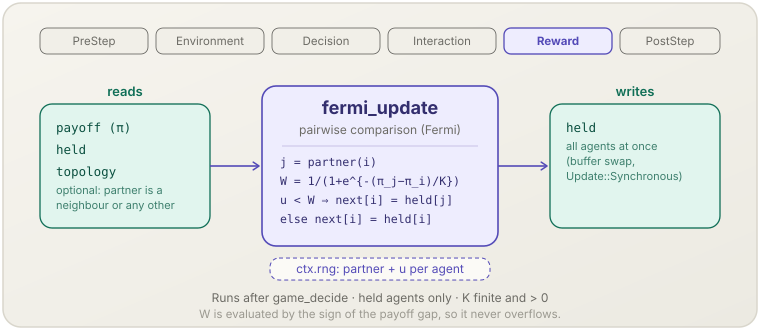

[English](fermi-update.md) | **日本語**

# フェルミ則（`fermi_update`）

> Held の各エージェントが無作為な相手 1 人と自分を比べ，利得の差のフェルミ関数で決まる確率で相手の行動を採ります．全員が一斉に更新します．
> **フェーズ：** Reward．**出典：** Szabó & Tőke（1998）．**種別：** stochastic imitation．

[← Mechanism カタログに戻る](../mechanisms.ja.md)

## 1. 概要

`fermi_update` は [`socsim-games`](../games.ja.md#集団動学) の 4 つの集団動学の 1 つです．
`assemble_with` の引数 `dynamics` に `FermiUpdate::new(k, update)?` を渡すと登録され，全エージェントが **Held** の World で動きます．
ステップの対戦が終わった後，各エージェント $i$ は次を行います．

1. 比較の相手 $j$ を 1 人引きます．トポロジーの近傍から，トポロジーの無い World ではほかの全エージェントから一様に引きます．
2. 確率 $W = 1/(1 + \exp[-(\pi_j - \pi_i)/K])$ で $j$ の保持行動を採り，そうでなければ自分の行動を保ちます．
3. 全エージェントについて一斉に，結果を `held` に書きます．

[`imitate_best`](imitate-best.ja.md) と違い，稼ぎの少ない相手も 1/2 未満の確率で写します．雑音 $K$ が，利得の差がどれだけ鋭く効くかを決めます．

## 2. 理論と出典

Szabó & Tőke（1998）は，プレイヤー $x$ が近傍 $y$ の戦略を次の確率で採る対比較を導入しました．

$$W(\pi_x \to \pi_y) = \frac{1}{1 + \exp\!\big[-(\pi_y - \pi_x)/K\big]}$$

- $\pi_i$ — そのステップのエージェント $i$ の利得（`world.payoffs()`．`PayoffAggregation` の後）．
- $K > 0$ — 比較の雑音．$\beta = 1/K$ は選択の強さです（Traulsen, Nowak & Pacheco, 2006）．
  $K \to 0$ では «より稼いだ相手を写す» 決定的な規則に近づき，$K$ が大きいと利得に依らず確率 1/2 で写す規則に近づきます．

$W$ はどの利得の組でも $(0, 1)$ に入るので，$K$ には有限かつ正であること以外の制約は要りません．
実装は $z = (\pi_j - \pi_i)/K$ として，$z \ge 0$ なら $1/(1 + e^{-z})$，$z < 0$ なら $e^{z}/(1 + e^{z})$ で $W$ を計算するので，指数が溢れることはありません．
利得が等しいとき $W = 1/2$ です．

## 3. データフロー



そのステップの利得，保持行動，トポロジーがあればその近傍の一覧を読みます．
ステップの RNG から，エージェントごとに相手と一様乱数を 1 つずつ引きます．
保持行動を書きます．全エージェントを評価し終えてから一時バッファと入れ替えます．

## 4. 6フェーズループにおける位置

**Reward** に，`game_decide` の後（したがって学習の後）に登録されます．読む利得は Interaction で `game_play` が書いたものです．
PostStep では，`world.held()` は次のステップの行動を持ち，`world.payoffs()` は打ったばかりのステップを表します
（[`PostStep` で見えるもの](../games.ja.md#poststep-で見えるもの) を参照）．

## 5. 状態の読み書きコントラクト

| フィールド | 読み | 書き | 備考 |
|---|:--:|:--:|---|
| `GameWorld.payoff` | ✓ | | エージェントごとに 1 つ．有限でない利得はステップを止める． |
| `GameWorld.held` | ✓ | ✓ | 次の行動はすべて更新前の `held` から計算し，一斉に書く（`Update::Synchronous`）． |
| `GameWorld.topology` | ✓ | | 相手は近傍（有向ネットワークでは出近傍）．`Topology::None` ではほかの任意のエージェント． |
| `PolicyTable.slot` | ✓ | | 組み立て時に 1 回検査する．全エージェントが Held でなければならない． |

## 6. 依存関係と順序制約

- **上流：** `game_play`（Interaction）がそのステップの利得を書いていること．Matching もトポロジー（無くてもよい）も何でも動きます．
- **Held のエージェントだけ：** 決定規則を持つエージェントがいる World は `assemble_with` が拒否します（`GameError::Population`）．
- **共通の行動の集合：** ゲームが `CommonActionSpace` を実装し（コンパイル時），すべての役割の行動数が等しくなければなりません（`GameError::Population`）．
- **比較の相手と対戦の相手は別です．** 比較の相手はそのステップの対戦からではなくトポロジーから引きます．
  トポロジーの無い World の `RandomPairs` では，対戦しなかったエージェントと比べることもあります．
- **下流：** 次のステップは新しい保持行動で対戦します．
  `MetricsOptions::population_share(true)` の [`game_metrics`](game-metrics.ja.md) が更新後の割合を記録します．

## 7. パラメータ

| パラメータ | 既定 | 種別 | 備考 |
|---|---|---|---|
| `k: f64` | —（必須） | tunable | 雑音 $K$．有限かつ `> 0` でなければ `FermiUpdate::new` が `GameError::Population` を返す．上限は無い． |
| `update: Update` | —（必須） | structural | `Update::Synchronous`．方式はこれだけで，既定値は無い． |

## 8. 適用方法

ライブラリ専用です．`assemble_with` の引数 `dynamics` に設定を渡します．

### ライブラリモード

```rust
use socsim_games::{
    assemble_with, FermiUpdate, NetworkEdges, NormalFormOutcome, Pairwise, PayoffAggregation,
    PlayOptions, Topology, Update,
};

let world = build_world(game, n, (), initial, &rules, &held, 1, steps, seed)?
    .with_topology(Topology::network(network))?;          // feature `net`
let mut sim = assemble_with(
    world,
    NetworkEdges::new(),                                   // one encounter per edge
    rules,                                                 // an empty RuleBook: every agent is held
    Pairwise::new(NormalFormOutcome),
    FermiUpdate::new(0.1, Update::Synchronous)?,           // K = 0.1
    PlayOptions::new().payoff_aggregation(PayoffAggregation::Mean),
    seed,
)?
.build();
```

よく混ざった集団では，トポロジーを付けずに `RandomPairs::new()` や `WholePopulation::new()` などの Matching を使います．
[`docs/games.ja.md` の「シミュレーションの中の匿名ゲーム」](../games.ja.md#シミュレーションの中の匿名ゲームcounting_play) のエル・ファロルの例を参照してください．

## 9. 決定論性と RNG

エンジンのストリーム（`derive_seed(seed, &[1])`，ステップの RNG）から引きます．
エージェントを `AgentId` の昇順に訪れ，各自が `gen_range` で相手を 1 人，続いて一様な `f64` を 1 つ引き，その値が $W$ より小さければ相手の行動を採ります．
近傍を持たないエージェントは何も引きません．
ステップの間に状態を持たないので，snapshot から正確に再開でき，同じ seed の 2 回の実行はステップごとに一致します．

## 10. 期待される動作

- 利得が等しいとき，各エージェントはちょうど確率 $1/2$ で相手を写します．$\pi_j - \pi_i = K \ln 3$ なら確率は $3/4$ です．
- [`docs/games.ja.md`](../games.ja.md#シミュレーションの中の匿名ゲームcounting_play) のエル・ファロルの例（100 人で 1 つの対戦，$K = 0.1$，初期の出席者 80 人）では，
  最初の 3 ステップの出席者数は 80，60，86 です．$-1$ を得た出席者は欠席者の相手を確率 $1/(1 + e^{-10}) \approx 1$ で写し，
  次のステップでは欠席者が $+1$ を得た出席者を写します．
- `PrisonersDilemma::weak(1.5)` と $K = 0.1$ の，200 人の無作為な 4 正則ネットワークでは，同じ seed の 2 回の実行は毎ステップ `held`，利得，指標の行が一致し，
  snapshot から再開した実行も同じように続きます．

## 11. 参考文献

- Szabó, G., & Tőke, C. (1998). Evolutionary prisoner's dilemma game on a square lattice. *Physical Review E*, 58(1), 69–73.
- Traulsen, A., Nowak, M. A., & Pacheco, J. M. (2006). Stochastic dynamics of invasion and fixation. *Physical Review E*, 74(1), 011909.
