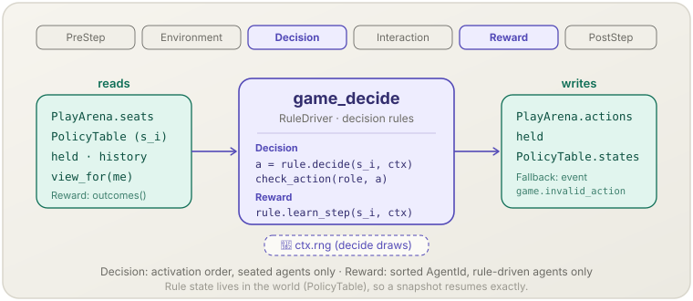

**English** | [日本語](game-decide.ja.md)

# Game decision (`game_decide`)

> Each seated agent's decision rule chooses an action; after play, the rules learn.
> **Phase:** Decision + Reward. **Source:** game-theoretic simulation (decision rules). **Kind:** rule-driven.

[← Back to the mechanism catalog](../mechanisms.md)

## 1. Overview

`game_decide` (the `RuleDriver` type) is the second of the three
[`socsim-games`](../games.md) mechanisms. It drives every agent's
`DecisionRule`:

- in **Decision** it asks each seated agent for an action — through its rule,
  or, for a `Held` agent, from its held action — checks the action with
  `StageGame::check_action`, and stores it in the agent's seats. How many
  decisions an agent makes is set by the **decision scope**
  (`PlayOptions::decision_scope`): one per step (`PerStep`, the default, which
  also updates the agent's held action), one per role the agent holds that step
  (`PerAgentRole`), or one per seat (`PerEncounter`);
- in **Reward** it calls, for every rule-driven agent, `learn_encounter` once
  per encounter of that agent (when the rule asks for it) and then `learn_step`,
  with this step's record and encounter outcomes;
- with `PlayOptions::report_mixed(true)`, at the **end of Reward** — after every
  agent has learned — it asks each rule-driven agent's rule for its mixed
  strategy in every role (`DecisionRule::mixed`) and stores the reports in the
  world, where `GameWorld::reported_mixed(agent, role)` reads them.

The rule objects themselves are shared code. Every agent's rule state lives in
the world's `PolicyTable`, so the mechanism holds no state that matters for a
resumed run.

`game_decide` drives only the kinds of its `RuleBook`. Which driver owns a kind
is fixed by the `KindCatalog`: with the `llm` feature, kinds registered in an
`LlmRuleBook` belong to [`game_llm_decide`](game-llm-decide.md), and
`game_decide` skips those agents in both Decision and Reward, leaving their
seats for `game_llm_decide`, which `assemble_with_llm` registers right after
`game_decide`.

## 2. Theory & source

A decision rule is a behavioural strategy for the repeated game: a map from
what the agent knows to an action, plus an update of its internal state.

$$a_i^t = \text{decide}_{k(i)}\big(s_i,\ \text{view}_i^t;\ \text{rng}\big), \qquad s_i \leftarrow \text{learn}_{k(i)}\big(s_i,\ \text{outcome}_i^t\big)$$

- $k(i)$ — the rule kind assigned to agent $i$ (`PolicyTable.kind`).
- $s_i$ — agent $i$'s rule state (`X::PolicyState`).
- $\text{view}_i^t$ — the `DecisionContext`: own role and encounter, current
  opponents, own history, opponents' action histories, and `X::view_for(i)`.

Built-in rules: `Fixed` (a constant action), `UniformRandom` (uniform over the
role's actions), `TitForTat` (Axelrod, 1984: cooperate first, then copy the
opponent's last action), `Mixed` (a fixed mixed strategy), `MyopicBestResponse`
(a best response to the opponents' previous actions), `FictitiousPlay`
(Brown, 1951; simultaneous updating, two players — in Shapley's 1964 example it
cycles without converging), `LogitChoice` (a logit
response to the opponent's last or empirical actions), `RothErev` (the
three-parameter reinforcement rule of Erev & Roth, 1998, with forgetting `φ`
and experimentation `ε`) and `Automaton` (ALLC, ALLD, GRIM, TFT, WSLS — Nowak &
Sigmund, 1993 — and generous TFT). The learning arithmetic is in
`socsim_games::learn`; see
[Learning rules and decision scope](../games.md#learning-rules-and-decision-scope).

With a decision scope finer than `PerStep`, `decide` is called once per
decision unit — $(t, i, \text{role})$ under `PerAgentRole`,
$(t, i, \text{encounter})$ under `PerEncounter` — instead of once per
$(t, i)$. In every scope the learning update is one call per encounter (for
rules that ask for it) followed by one call per step:

$$s_i \leftarrow \text{learn}^{\text{step}}_{k(i)}\Big(\text{learn}^{\text{enc}}_{k(i)}\big(\cdots \text{learn}^{\text{enc}}_{k(i)}(s_i,\ o_{i,1}^t) \cdots,\ o_{i,m}^t\big)\Big)$$

where $o_{i,1}^t, \dots, o_{i,m}^t$ are agent $i$'s encounter outcomes in
`EncounterId` order, $\text{learn}^{\text{enc}}$ is `learn_encounter` and
$\text{learn}^{\text{step}}$ is `learn_step`.

A rule is distinct from a `socsim_marl::Policy`: a
`DecisionRule` is a game-layer strategy over `G::Action` with its state stored
in the world, not a neural policy over an observation vector.

## 3. Data flow



Decision reads the seats written by `game_match`, each agent's rule kind and
state, held actions, history, the pair history (when enabled) and `X`, and
writes the chosen actions into the seats, the held actions (under `PerStep`
only) and the rule states (`decide` may mutate its state). Reward reads the
step's records and encounter outcomes written by `game_play` and updates the
rule states; with `report_mixed`, it then writes the mixed-strategy reports.

## 4. Position in the 6-phase loop

Registers **Decision** and **Reward**.

- **Decision** — after `game_match` in the same phase (registration order), so
  the encounters exist. Agents are visited in the scheduler's activation order
  (`ctx.agent_order`); unseated agents and agents of LLM kinds are skipped.
  Within one agent, decisions follow the decision unit: one per step; one per
  role in ascending role order (`PerAgentRole`); or one per seat in
  `EncounterId` order (`PerEncounter`).
  With `assemble_with_llm`, `game_llm_decide` runs next in the same phase and
  fills the LLM agents' seats.
- **Reward** — after `game_play` (Interaction) has filled payoffs and appended
  the step history, so learning sees the complete step. Agents are visited
  in sorted `AgentId` order; `Held` agents and agents of LLM kinds are skipped
  (`game_llm_decide`'s Reward runs after this one). For each agent whose rule
  returns `needs_encounter_learning() == true`, `learn_encounter` is called
  once per encounter of that agent in `EncounterId` order; `learn_step` follows.
  The built-in learning rules update one state per opponent in
  `learn_encounter` under `PerEncounter`, and a single global state in
  `learn_step` under the other scopes.
  With `report_mixed`, the reports are written after all agents have learned,
  again in sorted `AgentId` order: the report of step $t$ is the
  **post-learning** mix that the decision of step $t+1$ will use, not the mix
  that produced the action of step $t$.

## 5. State read/write contract

| Field | Read | Write | Notes |
|---|:--:|:--:|---|
| `PlayArena.seats` | ✓ | | Decision: which agents act, and in which role. |
| `PlayArena.actions` | | ✓ | Decision: the checked action for each seat. |
| `GameWorld.held` | ✓ | ✓ | Decision: a `Held` agent plays it in all its seats; under `PerStep` a rule-driven agent's action replaces it (not under `PerAgentRole` / `PerEncounter`). |
| `PolicyTable` (`kinds`, `slot`, `kind_of`, `states`) | ✓ | ✓ | `decide` and `learn_step` receive `&mut` to the agent's state. |
| step history, `game`, `x`, `ids`, `clock.t` | ✓ | | Through `DecisionContext` / `LearnContext`. |
| pair history | ✓ | | Decision: through `DecisionContext::pair_history` (current opponents) and `omniscient()`; exists only when a rule returns `needs_pair_history() == true`. Written by `game_play`. |
| `PlayArena.payoffs` / `credit` | ✓ | | Reward: through `LearnContext::outcomes()`. |
| Recorder event `game.invalid_action` | | ✓ | Only with `OnInvalidAction::Fallback`. |
| mixed-strategy reports | | ✓ | Reward, only with `report_mixed(true)`: cleared and stamped with `t`, then one `Option<Vec<f64>>` per rule-driven agent and role from `DecisionRule::mixed`. `None` for `Held` agents, kinds of another driver, rules that return `None` and non-finite values. Field `reports` of the world (omitted from the world JSON when off); survives snapshot/resume. |
| aggregate table | ✓ | | Decision: through `DecisionContext::aggregate_history()` (previous steps only); present only under `assemble_with_aggregates`. Written by `game_play`. |

## 6. Dependencies & ordering constraints

- **Upstream:** `game_match` (Decision) must have written the encounters;
  `game_play` (Interaction) must have written payoffs and the step history
  before Reward.
- **Downstream:** `game_play` requires every seat to hold an action; seats of
  LLM agents are filled by `game_llm_decide`, registered after `game_decide`.
  [`game_metrics`](game-metrics.md) with `MixedSource::Reported` reads this
  step's mixed-strategy reports in PostStep.
- **Mixed reports vs decision scope:** `report_mixed(true)` together with
  `DecisionScope::PerEncounter` is rejected by `assemble`
  (`GameError::Metrics`) — the learning rules keep one state per opponent there,
  and `mixed` reads the single global state.
- **Decision scope vs matching:** under `PerStep` an agent must hold one role
  per step. `RoundRobin` rejects `PerStep` at `assemble` when it would seat an
  agent in two roles; otherwise `game_decide` stops the step with
  `RuleError::AmbiguousRole` (also for `Held` agents). The same scope is passed
  to `game_match` (through `MatchContext::decision_scope`) and `game_play`.
- **Information structure:** the default view shows only opponents in the
  agent's own encounter (`opponent_history` and `pair_history` return `None`
  for anyone else);
  the whole world is readable only through `omniscient()`. During Decision,
  `held` read through `omniscient()` may depend on activation order.

## 7. Parameters

| Parameter | Default | Kind | Notes |
|---|---|---|---|
| `rules: RuleBook<G, X>` | — | structural | Passed to `assemble`; kinds registered by name. |
| `opts.on_invalid_action` | `OnInvalidAction::Stop` | policy | `Stop`: an invalid action fails the step. `Fallback(map)`: replace by the kind's fallback action and record `game.invalid_action`. |
| `opts.decision_scope` | `DecisionScope::PerStep` | structural | `PerStep` / `PerAgentRole` / `PerEncounter`; also passed to `game_match` and `game_play`. LLM decisions support `PerStep` only. |
| `opts.report_mixed` | `false` | observation | Write post-learning mixed-strategy reports at the end of Reward. Not with `PerEncounter`. What each built-in rule reports is listed in [`docs/games.md` § Reporting mixed strategies](../games.md#reporting-mixed-strategies). |

The `Fallback` map covers this mechanism's kinds only; LLM kinds are not
listed there (their fallback is the `RetryProtocol` of the LLM rule).
With `Fallback`, `assemble` requires a fallback for every rule kind in use and
checks each fallback with `check_action` for every role. The event payload is
`{ "agent", "kind", "role", "action" }` (the rejected action, `Debug`-formatted).

## 8. How to apply

Library-only; `assemble` constructs `game_decide` from `rules` and `opts`.

### Library mode

```rust
use std::collections::BTreeMap;
use std::sync::Arc;
use socsim_games::{
    assemble, FixedPlayers, NormalFormOutcome, OnInvalidAction, PlayOptions, RuleBook,
    TitForTat, UniformRandom,
};

let mut rules = RuleBook::new();
rules.register("tit_for_tat", Arc::new(TitForTat::new(0)))?;
rules.register("uniform_random", Arc::new(UniformRandom))?;
// build_world(game, n, x, initial_held, &rules, &assignment, history_len, t_max, seed)?

let opts = PlayOptions::new().on_invalid_action(OnInvalidAction::Fallback(BTreeMap::from([
    ("tit_for_tat".to_owned(), 0),
    ("uniform_random".to_owned(), 0),
])));
let sim = assemble(world, FixedPlayers::pairs(&[(0, 1)]), rules, NormalFormOutcome, opts, seed)?
    .build();
```

For a round-robin in which each agent keeps one learning state per opponent,
pass `RoundRobin::new()` as the matching and
`PlayOptions::new().decision_scope(DecisionScope::PerEncounter)`; a complete,
runnable tournament is in
[the worked example](../games.md#worked-example-a-round-robin-ipd-tournament)
(`examples/ipd_tournament.rs`).

## 9. Determinism & RNG

`decide` receives the engine step RNG (`ctx.rng`, from `derive_seed(seed, &[1])`);
`UniformRandom` draws from it, `Fixed` and `TitForTat` do not. The stream is
consumed in activation order and, within one agent, in decision-unit order.
`Mixed`, `LogitChoice`, `RothErev` and GTFT (after an opponent's defection,
with `0 < generosity < 1`) draw one uniform `f64` per decision and walk the
cumulative probabilities in action-index order; random tie-breaking
(`FictitiousPlay`, `MyopicBestResponse`) draws one `gen_range` over the tied
actions. `learn_encounter` and `learn_step` receive no RNG, and neither does `mixed`:
reporting draws nothing and changes no rule state, so it does not change a
run. Rule-state
initialisation (in `build_world`) uses `derive_seed(seed, &[3, agent, generation])`,
and `derive_seed(seed, &[2])` is stored as the world's `decision_root`; both
labels are reserved. Learning visits agents in sorted `AgentId` order, and
decisions follow the scheduler's order, so a run is reproducible for a given
seed — and exactly resumable from a snapshot, because all rule state is in the
world.

## 10. Expected behaviour

In the iterated prisoner's dilemma `TitForTat` versus `Fixed(D)`, `TitForTat`
cooperates in the first step and defects from the second step on; over 100
rounds the scores are 99 and 104 (`examples/ipd_pair.rs`). A rule that returns
an out-of-range action stops the step under `Stop`, and is replaced (with one
`game.invalid_action` event per occurrence) under `Fallback`.

In a 200-round round-robin of ALLC, ALLD, TFT, GRIM and WSLS automata under
`PerEncounter` (`examples/ipd_tournament.rs`), the totals are 1800, 2008, 1999,
1999 and 1900; TFT loses only the first round against ALLD (199 to 204) and
cooperates with everyone else.

## 11. References

- Axelrod, R. (1984). *The Evolution of Cooperation*. Basic Books.
- Brown, G. W. (1951). Iterative solution of games by fictitious play. In T. C. Koopmans (Ed.), *Activity Analysis of Production and Allocation* (pp. 374–376). Wiley.
- Erev, I., & Roth, A. E. (1998). Predicting how people play games: Reinforcement learning in experimental games with unique, mixed strategy equilibria. *American Economic Review*, 88(4), 848–881.
- Nowak, M., & Sigmund, K. (1993). A strategy of win-stay, lose-shift that outperforms tit-for-tat in the Prisoner's Dilemma game. *Nature*, 364, 56–58.
- Shapley, L. S. (1964). Some topics in two-person games. In M. Dresher, L. S. Shapley, & A. W. Tucker (Eds.), *Advances in Game Theory* (pp. 1–28). Princeton University Press.
