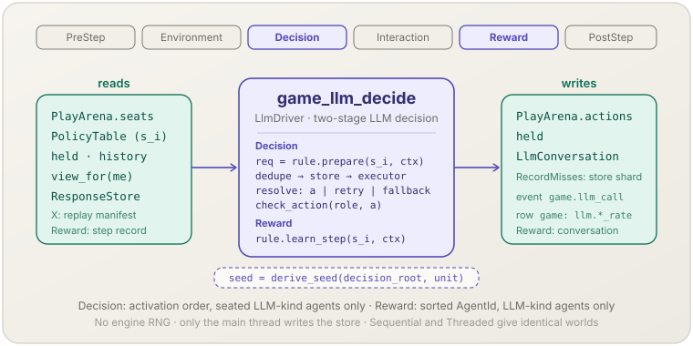

[English](game-llm-decide.md) | **日本語**

# ゲームの LLM による決定（`game_llm_decide`）

> 種類が LLM の規則である席に着いた各エージェントが要求を描画し，そのステップの要求を 1 つのバッチとして送り（まずストア，見つからなければバックエンド），応答を再試行とフォールバックを交えて検査済みの行動にします．
> **フェーズ：** Decision ＋ Reward．**出典：** 繰り返しゲームの LLM エージェント．**種別：** LLM-driven．

[← Mechanism カタログに戻る](../mechanisms.ja.md)

## 1. 概要

`game_llm_decide`（型は `LlmDriver`．feature `llm` ＋ `engine`）は，言語モデルにエージェントの行動を選ばせる [`socsim-games`](../games.ja.md) の Mechanism です．
`assemble_with_llm` が `game_decide` の後，`game_play` の前に登録します．`LlmRuleBook` の `LlmDecisionRule` を二段階で動かします．

- **Decision** では，担当する種類の席に着いた各エージェントについて `prepare` を呼び，そのステップの要求を 1 つのバッチとして送ります
  （重複を除き，`ResponseStore` を引き，見つからなかったものだけを `LlmExecutor` で実行する）．その後で各応答に `resolve` を呼びます．
  違反は次のバッチで再試行するかフォールバックで置き換えます．確定した行動はすべて `StageGame::check_action` で検査し，席と保持行動に書きます．
- **Reward** では，担当する種類の全エージェントについて `learn_step` を呼びます（組込みの `LlmPolicy` はそのステップの利得を会話の記録に書く）．
  Reward ではモデルを呼びません．

どの種類を担当するかは `KindCatalog` で決まります．`LlmRuleBook` の種類は `game_llm_decide` が，`RuleBook` の種類は [`game_decide`](game-decide.ja.md) が担当します．
各 Driver は相手のエージェントを飛ばすので，LLM のエージェントと規則で動くエージェントが 1 つの World を共有できます．

## 2. 理論と出典

LLM エージェントの行動戦略は，観測，プロンプトのレンダラ，モデル，パーサの合成です．

$$a_i^t = \text{parse}\Big(\text{LLM}\big(\text{render}(o_i^t);\ \theta,\ \sigma_i^t\big)\Big), \qquad o_i^t = \text{observe}(\text{view}_i^t)$$

- $o_i^t$ — エージェントの `DecisionContext` だけから作る観測（`OwnHistoryObs`：自分の直近の記録と現在の相手の直前の行動．`CountsObs`：相手の直前の行動ごとの人数）．
- $\theta$ — 生成の条件（`LlmConfig`：temperature，`max_tokens` など）．
- $\sigma_i^t$ — 生成のシード．決定単位から導く（§9）．
- $\text{parse}$ — `LabelParser`（JSON の応答の中のラベルの完全一致，または最初に現れたラベルによる緩い照合）．
  違反のときは指摘を付けて再試行し，それでも駄目ならフォールバック（前の行動，一様乱数，指定した行動）を使います．

モデルは，応答を**記録して再生する**確率的な神託として扱います．要求は完全なキー（バックエンド，system，プロンプト，temperature，seed など）で識別するので，
固定した記録に対する実行は再現できます．LLM を経済ゲームや繰り返しゲームの模擬エージェントとして使う方法は Horton (2023) と Akata et al. (2023) に倣っています．

## 3. データフロー



Decision は，`game_match` が書いた席，各エージェントの種類と `LlmConversation`，保持行動，履歴，`X`（観測を通して），`ResponseStore` を読みます．
検査済みの行動を席と保持行動に書き，各エージェントの会話に 1 ターンを追記し，新しい記録をストアのシャードに追記し（`RecordMisses`），
試行ごとに `game.llm_call` イベントを 1 件，`llm.*` の割合を表 `game` に 1 行記録します．
Reward は，`game_play` が書いたそのステップの記録を読み，会話を更新します．

## 4. 6フェーズループにおける位置

**Decision** と **Reward** に登録されます．

- **Decision** — 登録順で `game_match`（対戦ができている）と `game_decide`（規則で動くエージェントの席が埋まっている）の後，
  全席に行動があることを要求する `game_play`（Interaction）の前に動きます．
  要求はスケジューラーの活性化の順（`ctx.agent_order`）に準備し，席のないエージェントと `Held` のエージェントは飛ばします．
  応答はバッチ全体が返ってから同じ順に確定し，すべての決定が確定してから行動を書きます．
- **Reward** — `game_play` が利得とステップ履歴を書いた後，`game_decide` の `learn_step` の後に動きます．
  エージェントは `AgentId` の昇順に訪れ，他の種類のエージェントと `Held` のエージェントは飛ばします．

## 5. 状態の読み書きコントラクト

| フィールド | 読み | 書き | 備考 |
|---|:--:|:--:|---|
| `PlayArena.seats` | ✓ | | Decision：行動するエージェントとその役割． |
| `PlayArena.actions` | | ✓ | Decision：LLM のエージェントの各席の検査済みの行動． |
| `GameWorld.held` | ✓ | ✓ | Decision：`ResolveContext::previous`（`Fallback::Previous` 用）．確定した行動で置き換える． |
| `PolicyTable`（`kinds`，`slot`，`kind_of`，`states`） | ✓ | ✓ | `prepare` は状態を読む．`resolve` と `learn_step` は `&mut`（`LlmConversation`）を受け取る． |
| ステップ履歴，`game`，`x`，`ids`，`clock.t` | ✓ | | `DecisionContext` / `LearnContext` を通して． |
| `GameWorld.decision_root` | ✓ | | 生成のシードとフォールバックのストリームの根． |
| `X` の manifest（`HasLlmManifest`） | ✓ | | 毎回の Decision でストアとバックエンドの識別と照合する． |
| `ResponseStore`（World の外） | ✓ | ✓ | 主スレッドで引く．`RecordMisses` では見つからなかったものをこの実行のシャードに追記する． |
| Recorder の行 `game`（`llm.*`） | | ✓ | LLM の決定が 1 つ以上ある Decision ごとに 1 行． |
| Recorder のイベント `game.llm_call` | | ✓ | 試行ごとに 1 件（再試行と重複除去した試行を含む）． |

## 6. 依存関係と順序制約

- **上流：** `game_match`（Decision）が対戦を書いていること．Reward の前に `game_play`（Interaction）が利得とステップ履歴を書いていること．
- **下流：** `game_play` はすべての席に行動があることを要求します．LLM のエージェントの席を埋めるのはこの Mechanism だけです．
- **種類：** World は両方の表を含む `KindCatalog` で作り（`build_world_with`），`assemble_with_llm` で組み立てます．
  `assemble_with_llm` は World の種類の一覧をそのカタログと照合します（`GameError::InvalidKinds`）．両方の表にある種類は `RuleError::DuplicateKind` です．
- **実験状態：** `X: HasLlmManifest`（`WithLlm<X>` を使う）．`LlmPolicy` には `X::PolicyState: Slot<LlmConversation>` も要ります．
- **情報構造：** 観測は `DecisionContext` だけから作る（`omniscient()` を使わない）ので，既定のビュー（自分の対戦の相手と `X::view_for(me)`）が保たれます．
- **役割の数：** `assemble_with_llm` は Matching が対応する役割の数（`Matching::supports_roles`）を受け付け，それ以外を `GameError::UnsupportedRoles` で拒否します．`FixedPlayers` なら 2 役割，`WholePopulation` ならエージェントごとに 1 役割です．

## 7. パラメータ

| パラメータ | 既定値 | 種別 | 備考 |
|---|---|---|---|
| `LlmSetup::new(book, store, backend, identity)` | — | structural | `LlmRuleBook`，`ResponseStore`，`BackendFactory`（キャッシュなし．各スレッドの中で構築），`BackendIdentity { model, endpoint }`． |
| `.config(LlmConfig)` | `LlmConfig::deterministic()` | generation | 各要求の基．`seed` は常に，`system` は要求が持つときに上書きされる． |
| `.executor(LlmExecutor)` | `Sequential` | execution | `Threaded { workers }` は有界のキューを通してワーカースレッドで呼ぶ． |
| `.options(ExecutorOptions)` | 下記 | execution | `#[non_exhaustive]`：`ExecutorOptions::default()` を書き換える． |
| `timeout` | 120 秒 | execution | 呼出しごと．`Threaded` だけ．時間切れの呼出しは再送せず，ステップが失敗する． |
| `max_backend_retries` | 3 | execution | バックエンドのエラーの後の再送．使い切るとステップが `RuleError::Backend` で失敗する． |
| `backoff_base` | 1 秒 | execution | k 回目の再送の前に `backoff_base × 2^(k-1)` 待つ． |
| `queue_per_worker` | 2 | execution | キューの容量 = `workers × queue_per_worker`． |
| ストアの `ReplayMode` | — | replay | `ReplayOnly`（見つからなければエラー），`RecordMisses`（見つからなければバックエンド → シャード），`Live`（ストアを使わない）． |
| `RetryProtocol { max_retries, fallback }`（`LlmPolicy` ごと） | `1`，`Fallback::Previous` | policy | `attempt < max_retries` の間は指摘を付けて再試行．その後 `Previous`，`UniformRandom`，`Specified(a)`． |
| `LabelParser`（`LlmPolicy` ごと） | — | policy | `strict()`（JSON の中のラベルの完全一致．どんなラベルでもよい）か `lenient()`（最初に現れたラベルへのフォールバック．ラベルは ASCII の `[A-Za-z0-9_-]+` だけ．初期化時に検査）．`require_reason`，`with_synonyms`． |
| `with_max_turns(n)`（`LlmPolicy` ごと） | 16 | policy | `LlmConversation` の記録の長さ． |

`OnInvalidAction` はこの Mechanism には効きません．その `Fallback` の表に書けるのは `RuleBook` の種類だけです．
LLM の種類の確定した行動が不正なら，ステップは `RuleError::InvalidAction` で止まります．

## 8. 適用方法

ライブラリ専用です．`assemble_with_llm` が `LlmSetup` から `game_llm_decide` を構築します．
そのまま動く完全なプログラムは [戦略形ゲーム › LLM による決定](../games.ja.md#llm-による決定) にあります．

### ライブラリモード

```rust
use std::sync::Arc;
use socsim_games::llm::{
    assemble_with_llm, BackendFactory, BackendIdentity, CountsObs, CountsRenderer, LabelParser,
    LlmExecutor, LlmPolicy, LlmReplayManifest, LlmRuleBook, LlmSetup, ReplayMode, ResponseStore,
    WithLlm,
};
use socsim_games::{build_world_with, FixedPlayers, KindCatalog, NormalFormOutcome, PlayOptions};

let mut llm_rules = LlmRuleBook::new();
llm_rules.register(
    "llm",
    Arc::new(LlmPolicy::new(CountsObs, CountsRenderer::default(), LabelParser::strict())),
)?;
let catalog = KindCatalog::new().with_rules(&rules)?.with_llm(&llm_rules)?;

let store = ResponseStore::open(dir, ReplayMode::RecordMisses, "run", seed)?;
let x = WithLlm { inner: (), llm: LlmReplayManifest::for_store(&store, identity.clone()) };
// build_world_with(game, n, x, initial_held, &catalog, &assignment, history_len, t_max, seed)?

let setup = LlmSetup::new(llm_rules, store, backend, identity)
    .executor(LlmExecutor::Threaded { workers: 4 });
let sim = assemble_with_llm(
    world, FixedPlayers::pairs(&[(0, 1)]), rules, setup, NormalFormOutcome, PlayOptions::new(), seed,
)?
.build();
```

テストでは，`backend` は `socsim_llm::mock::ScriptedClient` を返す `BackendFactory` のクロージャです．
feature `live` では，`socsim_games::llm::live_backend_factory()` がキャッシュなしの Ollama → OpenAI のバックエンドを返します．

## 9. 決定論性と RNG

`game_llm_decide` は**エンジンのステップの RNG（`ctx.rng`）を引きません**．必要なストリームはすべて World の `decision_root`（`derive_seed(seed, &[2])`）と決定単位から導きます．

| 用途 | シード |
|---|---|
| 生成のシード（`temperature == 0`） | `derive_seed(decision_root, &[0])`（全要求で同じ．同じプロンプトはキーと呼出しを 1 つに共有する） |
| 生成のシード（それ以外） | `derive_seed(decision_root, &[t, agent, 0, 0, attempt])` |
| `Fallback::UniformRandom` | `derive_seed(decision_root, &[t, agent, 0, 0, u64::MAX])` |

ストアを引き書くのは主スレッドだけで，応答は決定の順に確定するので，結果は活性化のタイミングにも実行器にもよりません．
`Sequential` と `Threaded { workers }` は同じ World を作ります．

再現性は応答に依存します．固定した記録に対する実行（`ReplayOnly`）は再現できます．
snapshot から正確に再開できるのは，`ReplayOnly` の場合，または `RecordMisses` で再開後の全要求がストアに当たった場合（`cache_hit`．`llm.cache_hit_rate == 1`）**だけ**です．
`Live` では何も保証しません．World は `WithLlm<X>` の中に `LlmReplayManifest { store_id, base_digest, mode, backend }` を持ちます．
Driver は毎回の Decision でそれを自分のストアとバックエンドの識別に照らし，違えば止まります．`verify_snapshot` は同じ照合を `restore` の前に行います．
`ResponseStore::merge_shards` が自動で呼ばれることはなく，呼ぶと `base_digest` が変わります．

## 10. 期待される動作

- 囚人のジレンマで常に `{"action": "D", …}` と答える台本のモデルを `TitForTat` と対戦させると，保持行動は 1 ステップ目の後に `[1, 0]`，2 ステップ目から `[1, 1]` です．
- temperature 0 で，同じ状況にある 2 人の LLM のエージェント（`CountsObs`）はステップごとにバックエンドを 1 回だけ呼びます．
  両方の試行が同じ `key` の `game.llm_call` イベントとして記録され，2 件目は `deduplicated: true` です．
- 形式に違反した応答は指摘を付けて再試行されます．再試行を使い切るとフォールバックを使い，`llm.giveup_rate` がそのエージェントを数えます．
- `ReplayOnly` での記録の欠落，バックエンドの再送の使い切り，`Threaded` での時間切れは，Mechanism のエラーでステップを止めます．

## 11. 参考文献

- Horton, J. J. (2023). *Large Language Models as Simulated Economic Agents: What Can We Learn from Homo Silicus?* NBER Working Paper 31122.
- Akata, E., Schulz, L., Coda-Forno, J., Oh, S. J., Bethge, M., & Schulz, E. (2023). *Playing repeated games with large language models*. Nature Human Behaviour (2025), doi:10.1038/s41562-025-02172-y. Preprint arXiv:2305.16867 (2023).
