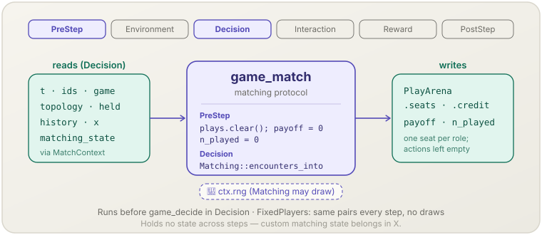

**English** | [日本語](game-match.ja.md)

# Game matching (`game_match`)

> Resets the per-step play state and seats agents into this step's encounters.
> **Phase:** PreStep + Decision. **Source:** game-theoretic simulation (matching protocol). **Kind:** structural.

[← Back to the mechanism catalog](../mechanisms.md)

## 1. Overview

`game_match` is the first of the three mechanisms that
[`socsim-games`](../games.md) registers for a normal-form game simulation. It
owns the *who plays whom* part of a step:

- in **PreStep** it clears the previous step's encounters (`PlayArena`) and the
  per-agent `payoff` and `n_played` counters;
- at the start of **Decision** it hands the world to the configured `Matching`,
  which writes this step's encounters — one seat per role — into the play arena.

Two matchings are built in: `FixedPlayers` (the same pairs every step) and
`RoundRobin` (every pair of agents every step).

It does not choose actions or compute payoffs; `game_decide` and `game_play`
do that from the encounters it writes.

## 2. Theory & source

In a repeated or evolutionary game simulation, the *matching protocol* decides
which agents meet in each round: fixed partners (a repeated two-player game),
random pairing, round-robin tournaments, or neighbours on a network. Keeping the
protocol separate from the stage game and from the decision rules lets the same
game and rules run under different interaction structures.

The `Matching<G, X>` trait expresses one protocol:

$$\text{encounters}_t = \mathcal{M}\big(t,\ \text{ids},\ \text{game},\ \text{held},\ \text{history},\ X;\ \text{rng}\big)$$

where each encounter is a tuple of agents (one per role) with a credit mode.
The built-in `FixedPlayers` returns the same pairs every step, which is the
standard repeated two-player game. The built-in `RoundRobin` returns every pair
$\{i, j\}$, $i < j$, every step — the round-robin tournament of Axelrod (1984) —
optionally in both orders $(i, j)$ and $(j, i)$.

In a round-robin an agent sits in several encounters per step, possibly in
different roles. How many decisions it then makes is the **decision scope**
(`PerStep`, `PerAgentRole`, `PerEncounter`; see
[Decision scope](../games.md#decision-scope)); the matching receives it as
`MatchContext::decision_scope()` so that `check` can reject a seating the scope
cannot express.

## 3. Data flow



PreStep empties the per-step fields. Decision reads the matching context
(`t`, the decision scope, agent ids, game, topology, held actions, step
history, `X`) and the `MatchingState`, and writes the encounters (`seats`, `credit`, empty action and
payoff slots) into the `PlayArena`.

## 4. Position in the 6-phase loop

Registers **PreStep** and **Decision**.

- **PreStep** runs before anything else in the step, so every later phase sees
  an empty arena and zeroed counters.
- **Decision**: `assemble` registers `game_match` before `game_decide`, and
  mechanisms in the same phase run in registration order — so encounters exist
  before any agent is asked for an action.

## 5. State read/write contract

| Field | Read | Write | Notes |
|---|:--:|:--:|---|
| `GameWorld.plays` (`PlayArena`) | | ✓ | PreStep: cleared. Decision: encounters appended through `ArenaWriter::push`. |
| `GameWorld.payoff` | | ✓ | PreStep: filled with `0.0`. |
| `GameWorld.n_played` | | ✓ | PreStep: filled with `0`. |
| `GameWorld.matching_state` | ✓ | ✓ | Passed mutably to `encounters_into`: `MatchingState::None` for `FixedPlayers`, `MatchingState::RoundRobin { cursor }` for `RoundRobin` (`cursor` += 1 per step). Serialised with the world. |
| `clock.t`, decision scope, `ids`, `game`, `topology`, `held`, step history, `x` | ✓ | | Read-only through `MatchContext` (`decision_scope()` returns `PlayOptions::decision_scope`). |

## 6. Dependencies & ordering constraints

- **Upstream:** none within the step. Held actions and history come from earlier
  steps (`game_decide`, `game_play`).
- **Downstream:** `game_decide` (Decision) reads the seats to decide which
  agents act and in which role; `game_play` (Interaction) evaluates every
  encounter. Agents that are not seated do not act or play this step.
- **Decision scope:** under `DecisionScope::PerStep` every agent must hold one
  role per step. `RoundRobin::check` therefore rejects `PerStep` with three or
  more agents or with `both_orders(true)`; a custom matching that cannot decide
  this up front is caught by `game_decide` at step time
  (`RuleError::AmbiguousRole`).
- Keep `game_match` registered first; `assemble` does this for you.

## 7. Parameters

| Parameter | Default | Kind | Notes |
|---|---|---|---|
| `matching: M` (`M: Matching<G, X>`) | — | structural | Passed to `assemble`. Built-in: `FixedPlayers::pairs(&[(a, b), …])` / `FixedPlayers::new(vec![[AgentId; 2], …])`, `RoundRobin::new()`. |
| `RoundRobin::both_orders(bool)` | `false` | structural | `true`: after each pair `(i, j)` also push `(j, i)`, so every agent plays both roles against every opponent. |
| `RoundRobin::self_play(bool)` | `false` | structural | `true` is rejected (self-play is not supported). |

`FixedPlayers::check` (run once in `assemble`) rejects an unknown agent, an agent
listed in more than one pair, and a game without exactly two roles
(`GameError::InvalidMatching`). `RoundRobin::check` rejects a game without
exactly two roles, `self_play(true)`, and — under `DecisionScope::PerStep` —
three or more agents or `both_orders(true)` (`GameError::InvalidMatching`).

`RoundRobin` sorts the agents by `AgentId` and pushes the pairs in
lexicographic order with the lower id in role 0: for four agents
`(0, 1), (0, 2), (0, 3), (1, 2), (1, 3), (2, 3)`; with both orders
`(0, 1), (1, 0), (0, 2), (2, 0), …`. All encounters use `Credit::All`.

A custom `Matching` keeps any state it needs in the experiment state `X`, not in
its own struct — the struct is code and is not part of a snapshot.

## 8. How to apply

`game_match` is library-only (no scenario-TOML registration) and is not
constructed directly: `assemble` creates it from the `matching` argument.

### Library mode

```rust
use socsim_games::{assemble, FixedPlayers, NormalFormOutcome, PlayOptions};

let mut sim = assemble(
    world,                              // from build_world(...)
    FixedPlayers::pairs(&[(0, 1), (2, 3)]),
    rules,
    NormalFormOutcome,
    PlayOptions::new(),
    seed,
)?
.build();
sim.step()?;
let arena = sim.world().plays();        // this step's encounters
```

For a round-robin, pass `RoundRobin::new()` (optionally `.both_orders(true)`)
and a decision scope that fits it, e.g.
`PlayOptions::new().decision_scope(DecisionScope::PerEncounter)`; see
[the worked example](../games.md#worked-example-a-round-robin-ipd-tournament)
(`examples/ipd_tournament.rs`).

## 9. Determinism & RNG

PreStep draws no randomness. In Decision, `encounters_into` receives the engine
step RNG (`ctx.rng`, seeded from `derive_seed(seed, &[1])`); neither
`FixedPlayers` nor `RoundRobin` draws from it. The `RoundRobin` cursor is part
of the world, so a resumed run continues the count. A randomised custom matching must draw only from that RNG so
that a run — and a resumed run — stays reproducible.

## 10. Expected behaviour

With `FixedPlayers::pairs(&[(0, 1)])`, `world().plays().n_encounters()` is `1`
after every step and both agents have `n_played == 1`. With pairs that do not
cover every agent, the uncovered agents have `n_played == 0` and a `None`
action in that step's `StepRecord`.

With `RoundRobin::new()` and `n` agents, each step has `n(n − 1)/2` encounters
(`n(n − 1)` with both orders), every agent has `n_played == n − 1`
(`2(n − 1)`), and after `k` steps the world's `matching_state` is
`RoundRobin { cursor: k }`. With `PayoffAggregation::Sum` three agents playing
`C`, `D`, `C` in the prisoner's dilemma `[[3, 0], [5, 1]]` receive
`[3, 10, 3]` per step; with `Mean`, `[1.5, 5, 1.5]`.

## 11. References

- Axelrod, R. (1984). *The Evolution of Cooperation*. Basic Books.
