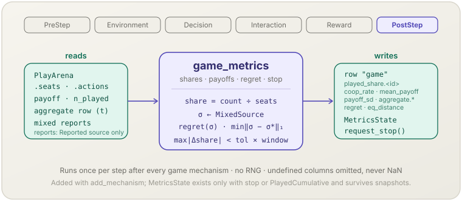

**English** | [日本語](game-metrics.ja.md)

# Game metrics (`game_metrics`)

> Records one row of per-step game statistics — action shares, payoffs, cooperation, regret, distance to equilibrium, public aggregates — and can end the run when play settles.
> **Phase:** PostStep. **Source:** game-theoretic summary statistics. **Kind:** observation.

[← Back to the mechanism catalog](../mechanisms.md)

## 1. Overview

`game_metrics` (`GameMetrics<G>`, `G: FiniteGame`) is the observation mechanism
of [`socsim-games`](../games.md). Unlike the other `game_*` mechanisms it is
**not** registered by `assemble`: you build it with
`GameMetrics::new(&game, MetricsOptions)` and add it to the builder. After every
step it

1. counts this step's seats in the play arena per action and writes
   `game.played_share.<id>` (and `game.coop_rate` when a cooperation label is
   configured; `game.action_entropy` under feature `metrics`);
2. writes `game.mean_payoff` and `game.payoff_sd` over the agents that played;
3. copies this step's public aggregate row as `game.aggregate.<name>` when the
   simulation was assembled with aggregates, and, with
   `population_share(true)`, writes `game.population_share.a<k>`, the share of
   all agents holding action `k`;
4. builds one mixed strategy per role from the configured `MixedSource` and
   writes `game.regret` and, with `EquilibriumTarget::Solve`, `game.eq_distance`;
5. updates its convergence counter and, once the shares have been stable for
   `window` steps, requests the end of the run.

A column whose value is undefined in a step is left out of the row; nothing is
ever recorded as NaN. The full column reference is in
[`docs/games.md` § Metrics](../games.md#metrics).

## 2. Theory & source

With $S_t$ the seats of step $t$, $a_s$ the action in seat $s$ and $r(s)$ its
role, the played shares are

$$p_t(k) = \frac{\lvert\{s \in S_t : a_s = k\}\rvert}{\lvert S_t\rvert} \ \ (\text{pooled ids}), \qquad p_t(r, k) = \frac{\lvert\{s \in S_t : r(s) = r,\ a_s = k\}\rvert}{\lvert\{s \in S_t : r(s) = r\}\rvert} \ \ (\text{per-role ids})$$

For a profile $\sigma = (\sigma_r)_r$ of one mixed strategy per role, with
$F_r$ role $r$'s expected payoff,

$$\text{regret}(\sigma) = \max_r \Big[\max_a F_r(a, \sigma_{-r}) - F_r(\sigma)\Big], \qquad \text{eq\_distance}(\sigma) = \min_{\sigma^* \in E} \sum_r \sum_a \big\lvert \sigma_r(a) - \sigma^*_r(a)\big\rvert$$

- Regret is zero exactly at a Nash equilibrium (Nash, 1951); it is the
  unilateral-deviation gain used throughout the learning-in-games literature
  (e.g. Hart & Mas-Colell, 2000).
- $E$ is the complete equilibrium set of a two-player game, found once by
  support enumeration.
- `game.action_entropy` is the Shannon (1948) entropy $-\sum_k p_t(k) \ln p_t(k)$
  in nats.

With $A$ the agents and $h_i$ agent $i$'s held action at PostStep, the
population share is

$$q_t(k) = \frac{\lvert\{i \in A : h_i = k\}\rvert}{\lvert A\rvert}$$

It differs from $p_t$ twice: it counts agents rather than seats, and under
[population dynamics](../games.md#population-dynamics) it describes the
actions **after** the step's update (those of the next step), while $p_t$
describes the actions played in the step.

## 3. Data flow



Reads the play arena (`seats`, `actions`) — or, on the implicit play path, the
per-role counts of the played actions that `game_play` kept for the step — the
held actions (for `population_share`), the per-agent `payoff` and
`n_played`, the last aggregate row and, for `MixedSource::Reported`, the
mixed-strategy reports. Writes one row to the recorder's table `"game"` and,
only when `stop` or `MixedSource::PlayedCumulative` is configured, its own
`MetricsState` in the world.

## 4. Position in the 6-phase loop

Registers **PostStep**. By then `game_play` (Interaction) has filled the
payoffs and the aggregate row and `game_decide` (Reward) has written the
post-learning reports, so the mechanism sees the completed step. No game
mechanism reads its output; a mechanism you add after it in PostStep runs
after it.

## 5. State read/write contract

| Field | Read | Write | Notes |
|---|:--:|:--:|---|
| `PlayArena.seats`, `actions` | ✓ | | A seat's role is its index modulo the role count. Every action must be `Some` and inside its role. |
| per-role played-action counts | ✓ | | Read instead of the arena when the step ran on the implicit path (the arena is empty). Same shares, `coop_rate`, regret and cumulative counts. |
| `GameWorld.held` | ✓ | | Only with `population_share(true)`; a held action outside the common action set is an error. |
| `GameWorld.payoff`, `n_played` | ✓ | | Only agents with `n_played > 0` enter `mean_payoff` / `payoff_sd`. |
| `game` | ✓ | | Role and action counts are checked against the game passed to `new`; payoffs are used for regret. |
| aggregate table | ✓ | | Only the last row, and only if its `t` is this step's. |
| mixed-strategy reports, `PolicyTable` slots | ✓ | | `MixedSource::Reported` only. The reports must be this step's; `Held` seats count as pure strategies. |
| `MetricsState { prev, below, cumulative }` | ✓ | ✓ | Created on the first step when `stop` or `PlayedCumulative` is set; field `metrics_state` of the world (omitted from the world JSON otherwise). Survives snapshot/resume. |
| recorder table `"game"` | | ✓ | One `record_row` per step. |
| stop request | | ✓ | `StepContext::request_stop` when the convergence counter reaches `window`. |

Policy states, held actions, plays and payoffs are never written: adding
`game_metrics` does not change the trajectory of a run.

## 6. Dependencies & ordering constraints

- **Upstream:** `game_match` / `game_decide` / `game_play` must have run (any
  `assemble*` function). `game.aggregate.<name>` needs
  `assemble_with_aggregates`; `MixedSource::Reported` needs
  `PlayOptions::report_mixed(true)` (otherwise the first step fails), and every
  seated rule-driven agent must report a mix (`Fixed`, `MyopicBestResponse`,
  LLM kinds and rules without `mixed` do not).
- **Same game:** build it from the game you put into the world. Role and action
  counts are checked every step (mechanism error on a mismatch); the
  equilibria for `eq_distance` come from the game given to `new`.
- **One per simulation:** the world has a single `MetricsState`, so add one
  `game_metrics`.
- **Downstream:** no game mechanism reads its output. With `stop`, the engine
  ends the run after the step in which the stop was requested.

## 7. Parameters

| Parameter | Default | Kind | Notes |
|---|---|---|---|
| `cooperate_label(label)` | off | observation | Adds `game.coop_rate`. Must match exactly one action label in every role (`GameError::Metrics`). |
| `regret(on)` | on iff the game has two roles | observation | `game.regret`. |
| `mixed_source(MixedSource)` | `Played` | observation | `Played` (this step's seats), `PlayedCumulative` (all seats since the first step; kept in the world), `Reported` (seat-weighted average of post-learning reports). |
| `equilibrium(EquilibriumTarget)` | `None` | observation | `Solve`: support enumeration once in `new`; two roles only; rejected if the solver fails or the equilibrium set is incomplete or empty. Adds `game.eq_distance`. |
| `stop(tol, window)` | off | control | Stop after `window` consecutive seated steps whose largest share change is `< tol`. `tol` finite `> 0`, `window ≥ 1`. |
| `action_entropy(on)` | on | observation | Feature `metrics` only; pooled ids only. |
| `population_share(on)` | off | observation | Adds `game.population_share.a<k>` (agents holding `k` ÷ all agents, after any population dynamics). Every role must have the same number of actions (`GameError::Metrics`). |

## 8. How to apply

Library-only. Build the mechanism, then add it to the builder returned by
`assemble` (or `assemble_with_aggregates` / `assemble_with_llm`):

### Library mode

```rust
use socsim_games::{EquilibriumTarget, GameMetrics, MetricsOptions, MixedSource};

let metrics = GameMetrics::new(           // before `game` moves into build_world
    &game,
    MetricsOptions::new()
        .cooperate_label("C")
        .mixed_source(MixedSource::PlayedCumulative)
        .equilibrium(EquilibriumTarget::Solve)
        .stop(1e-6, 20),
)?;
let columns = metrics.describe();         // (pattern, meaning) pairs for runvault.toml
let world = build_world(game, 2, (), InitialActions::Same(0), &rules, &Assignment::Ordered(vec![
    AssignGroup { kind: AssignKind::Rule("tit_for_tat".into()), count: 1 },
    AssignGroup { kind: AssignKind::Rule("fixed_defect".into()), count: 1 },
]), 100, 1000, seed)?;
let mut sim = assemble(world, matching, rules, NormalFormOutcome, PlayOptions::new(), seed)?
    .add_mechanism(Box::new(metrics))     // PostStep, after the game mechanisms
    .recorder(Box::new(recorder))
    .build();
sim.run()?;                               // may end before t_max via the stop rule
```

With Tit-for-Tat against a defector this run ends at `t = 22` (shares unchanged
from `t = 2`, twenty stable steps from `t = 3`). `describe()` lists the
columns of this configuration; see
[`docs/games.md` § Describing the columns](../games.md#describing-the-columns-describe)
for copying them into a runvault declaration.

## 9. Determinism & RNG

Draws **no** randomness and writes no model state, so a run with
`game_metrics` follows exactly the trajectory of the same run without it. The
row depends only on the completed step and on `MetricsState`, which is part of
the world; a resumed run therefore records the same values and stops at the
same step as an uninterrupted one.

## 10. Expected behaviour

In the prisoner's dilemma with $(T, R, P, S) = (5, 3, 1, 0)$, Tit-for-Tat
against an unconditional defector with `cooperate_label("C")`,
`EquilibriumTarget::Solve` and `stop(1e-9, 3)`:

- `t = 1`: `game.played_share.a0 = 0.5`, `game.played_share.a1 = 0.5`,
  `game.coop_rate = 0.5`, `game.mean_payoff = 2.5`, `game.payoff_sd = 2.5`,
  `game.regret = 1`, `game.eq_distance = 2`;
- `t ≥ 2`: `played_share.a1 = 1`, `coop_rate = 0`, `mean_payoff = 1`,
  `payoff_sd = 0`, `regret = 0`, `eq_distance = 0`;
- the run stops at `t = 5`.

In the hawk–dove example of
[`docs/games.md` § Population dynamics](../games.md#population-dynamics)
(1 000 held agents, 300 initial hawks, `RandomPairs`, proportional imitation)
with `population_share(true)`, `t = 1` records `game.played_share.a0 = 0.3`
(the hawks that played) and `game.population_share.a0 = 0.319` (the hawks after
the first update).

## 11. References

- Nash, J. (1951). Non-cooperative games. *Annals of Mathematics*, 54(2), 286–295.
- Hart, S., & Mas-Colell, A. (2000). A simple adaptive procedure leading to correlated equilibrium. *Econometrica*, 68(5), 1127–1150.
- Shannon, C. E. (1948). A mathematical theory of communication. *Bell System Technical Journal*, 27(3), 379–423.
