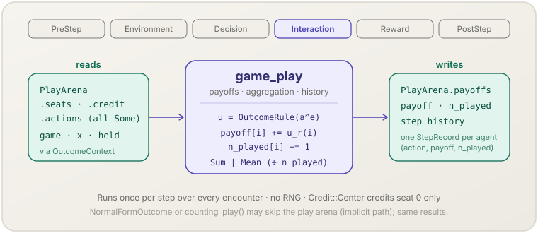

[English](game-play.md) | **日本語**

# ゲームの対戦（`game_play`）

> 各対戦の行動の組を利得に変え，エージェントごとに集計し，そのステップを記録します．
> **フェーズ：** Interaction．**出典：** 戦略形ゲームの利得．**種別：** structural．

[← Mechanism カタログに戻る](../mechanisms.ja.md)

## 1. 概要

`game_play` は，[`socsim-games`](../games.ja.md) の 3 つの Mechanism の 3 つ目です．
`game_match` が書き `game_decide` が埋めた各対戦について，次を行います．

1. すべての席に行動があることを検査します（埋まっていない席はエラー）．
2. 設定された `OutcomeRule` で役割ごとの利得を計算します．
3. 各利得を席のエージェントの `payoff` に足して `n_played` を 1 増やし，その後 `PayoffAggregation`（`Sum` か `Mean`）を適用します．
4. エージェントごとに `StepRecord { action, payoff, n_played }` を 1 つステップ履歴に追記します．

## 2. 理論と出典

戦略形ゲームでは，各役割 $r$ が行動の組 $a$ に対して $u_r(a_1, \dots, a_n)$ を受け取ります．
1 ステップに複数の対戦をしたエージェントのステップの利得は，それらの和か平均です．

$$\pi_i^t = \sum_{e \ni i} u_{r_e(i)}\big(a^{e}\big) \quad (\texttt{Sum}), \qquad \pi_i^t = \frac{1}{n_i^t}\sum_{e \ni i} u_{r_e(i)}\big(a^{e}\big) \quad (\texttt{Mean})$$

- $e \ni i$ — そのステップでエージェント $i$ が席に着いた対戦．$r_e(i)$ は $e$ における役割．
- $n_i^t$（`n_played`）— その対戦の数．

`NormalFormOutcome` は `NormalFormGame::payoffs_into` で $u$ を評価します．
独自の `OutcomeRule` は `X`，保持行動，トポロジー，対戦も使えます（例：評判で重み付けした利得）．

## 3. データフロー



対戦（`seats`，`credit`，`actions`）と，`OutcomeContext` を通してゲーム・`X`・保持行動・トポロジーを読みます．
席ごとの利得，エージェントごとの `payoff` と `n_played`，ステップ履歴を書きます．

## 4. 6フェーズループにおける位置

**Interaction** に登録されます．Decision（全行動が選ばれた後）より後，Reward（規則が結果から学習する．
利用者の Reward フェーズの Mechanism も `world.payoffs()` を読める）より前です．

## 5. 状態の読み書きコントラクト

| フィールド | 読み | 書き | 備考 |
|---|:--:|:--:|---|
| `PlayArena.seats`，`credit`，`actions` | ✓ | | 行動はすべて `Some` でなければならない．受け付けるのは `Credit::All` だけ． |
| `PlayArena.payoffs` | | ✓ | 席ごとに 1 つの利得． |
| `GameWorld.payoff` | ✓ | ✓ | エージェントごとに足し合わせ，`Mean` のときは `n_played` で割る． |
| `GameWorld.n_played` | ✓ | ✓ | エージェントが席に着いた対戦ごとに 1 増やす． |
| ステップ履歴（`StepRecord`） | | ✓ | エージェントごとに 1 件．席のないエージェントの `action` は `None`．長さ `history_len` の環． |
| `game`，`x`，`held`，`topology`，`clock.t` | ✓ | | `OutcomeContext` を通して． |

## 6. 依存関係と順序制約

- **上流：** `game_match`（PreStep）が `payoff` / `n_played` を 0 にします．これがないと利得がステップをまたいで積み上がります．
  `game_decide`（Decision）がすべての席を埋めていなければなりません．
- **下流：** `game_decide`（Reward）は `learn_step` のために新しいステップの記録と対戦の結果を読みます．
  次のステップの `DecisionContext::my_history` と `opponent_history` は，ここで書いた履歴を読みます．

## 7. パラメータ

| パラメータ | 既定値 | 種別 | 備考 |
|---|---|---|---|
| `outcome: O`（`O: OutcomeRule<G, X>`） | — | structural | `assemble` に渡す．組込み：`NormalFormOutcome`（`G: NormalFormGame` を要求）． |
| `opts.payoff_aggregation` | `PayoffAggregation::Sum` | structural | `Sum` か `Mean`．`Mean` では対戦しなかったエージェントは `0` のまま． |

## 8. 適用方法

ライブラリ専用です．`assemble` が `outcome` と `opts` から `game_play` を構築します．

### ライブラリモード

```rust
use socsim_games::{assemble, FixedPlayers, NormalFormOutcome, PayoffAggregation, PlayOptions};

let opts = PlayOptions::new().payoff_aggregation(PayoffAggregation::Mean);
let mut sim = assemble(world, FixedPlayers::pairs(&[(0, 1)]), rules, NormalFormOutcome, opts, seed)?
    .build();
sim.step()?;
let step_payoffs = sim.world().payoffs();          // reset every step
let last = sim.world().history(socsim_core::AgentId(0)).and_then(|h| h.last().cloned());
```

## 9. 決定論性と RNG

乱数は**引きません**．対戦は `EncounterId` の順に評価し，記録は `AgentId` の昇順に書くので，
結果は Decision で選ばれた行動だけで完全に決まります．

## 10. 期待される動作

$(T, R, P, S) = (5, 3, 1, 0)$ の囚人のジレンマで，エージェント 0 が協力しエージェント 1 が裏切ったステップでは，
`payoffs() == [0.0, 5.0]`，`n_played() == [1, 1]` になります．

## 11. 参考文献

- von Neumann, J., & Morgenstern, O. (1944). *Theory of Games and Economic Behavior*. Princeton University Press.
