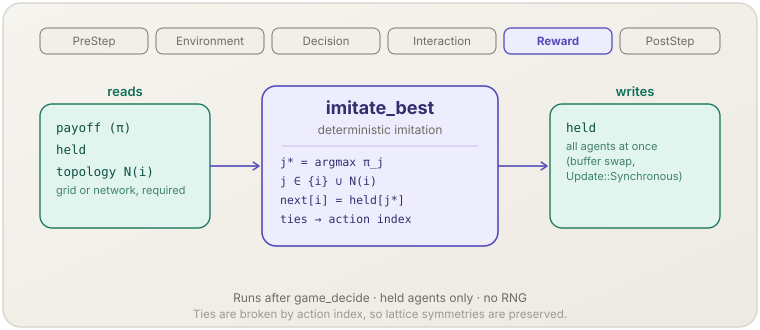

[English](imitate-best.md) | **日本語**

# 最良者の模倣（`imitate_best`）

> Held の各エージェントが，自分と近傍の中で最も稼いだエージェントの行動を採ります．全員が一斉に更新します．
> **フェーズ：** Reward．**出典：** Nowak & May（1992）．**種別：** deterministic imitation．

[← Mechanism カタログに戻る](../mechanisms.ja.md)

## 1. 概要

`imitate_best` は [`socsim-games`](../games.ja.md#集団動学) の 4 つの集団動学の 1 つです．
`assemble_with` の引数 `dynamics` に `ImitateBest::new(update)` を渡すと登録されます．
全エージェントが **Held**（決定規則を持たない）で，格子かネットワークの [トポロジー](../games.ja.md#トポロジーgameworldwith_topology) を持つ World で動きます．
ステップの対戦が終わった後，各エージェントは次を行います．

1. 自分の利得と，トポロジーの近傍の利得を見ます．
2. その中で最も利得の高いエージェントの保持行動を採ります．同点は行動の添字で破ります（パラメータを参照）．
3. 全エージェントについて一斉に，新しい行動を `held` に書きます．エージェントは次のステップでそれを打ちます．

空間囚人のジレンマの更新規則です．Moore 近傍の格子で `GridNeighborhood::new().include_self(true)` と弱い囚人のジレンマを使うと，
Nowak & May の «進化の万華鏡» を再現します．

## 2. 理論と出典

Nowak & May（1992）は，協力者と裏切り者を正方格子に置きます．
各セルは 8 つの近傍と自分自身を相手に $R = 1$，$T = b$，$S = P = 0$ の囚人のジレンマを行い，
次の世代では，各セルを近傍の中で最も得点の高いセルの戦略が占めます．全セルが同時に，決定的に更新します．

$$a_i^{t+1} = a_{j^*}^{t}, \qquad j^* \in \arg\max_{j \in \{i\} \cup N(i)} \pi_j^{t}$$

- $N(i)$ — トポロジーでのエージェント $i$ の近傍（整列済み，$i$ を含まない）．
- $\pi_j^t$ — ステップ $t$ のエージェント $j$ の利得（`world.payoffs()`．`PayoffAggregation` の後）．
- $a_j^t$ — ステップ $t$ にエージェント $j$ が保持していた行動．

最高の利得に複数のエージェントが並ぶときは，位置ではなく**行動の添字**で選ぶので，更新は格子のどの対称性とも可換です．対称な配置は対称なままです．
自己対戦つきの Moore 近傍の格子では，協力者の利得は整数 $m \in \{1, \dots, 9\}$，裏切り者の利得は $k\,b$（$k \in \{0, \dots, 8\}$）なので，
同期の発展が変わるのは $b$ が比 $m/k$ を跨ぐときだけです．$(1.8, 2)$ にはそのような比が無いので，この区間のどの $b$ でも発展は同じで，
無作為な初期配置からの協力者の割合は $0.318$ の周りで揺れます（Nowak & May, 1992）．

## 3. データフロー



そのステップの利得，保持行動，トポロジーの近傍の一覧を読みます．
保持行動を書きます．全エージェントを評価し終えてから一時バッファと入れ替えます．

## 4. 6フェーズループにおける位置

**Reward** に登録されます．`assemble_with` は `game_decide` の後に足すので，学習の後，ビルダーに足した Mechanism の前に動きます．
読む利得は Interaction で `game_play` が書いたものです．
したがって PostStep では，`world.held()` はすでに次のステップの行動を持ち，`world.payoffs()` と `world.plays()` は打ったばかりの行動を表します
（[`PostStep` で見えるもの](../games.ja.md#poststep-で見えるもの) を参照）．

## 5. 状態の読み書きコントラクト

| フィールド | 読み | 書き | 備考 |
|---|:--:|:--:|---|
| `GameWorld.payoff` | ✓ | | エージェントごとに 1 つ．有限でない利得はステップを止める． |
| `GameWorld.held` | ✓ | ✓ | 次の行動はすべて更新前の `held` から計算し，一斉に書く（`Update::Synchronous`）． |
| `GameWorld.topology` | ✓ | | 格子かネットワークの近傍．整列し重複を除いたもの．有向ネットワークでは出近傍． |
| `PolicyTable.slot` | ✓ | | 組み立て時に 1 回検査する．全エージェントが Held でなければならない． |

ほかには何も書きません．履歴も，対戦の表も，利得も書きません．

## 6. 依存関係と順序制約

- **上流：** `game_play`（Interaction）がそのステップの利得を書いていること．Matching は何でもよく，古典的な構成は `GridNeighborhood::new().include_self(true)` です．
- **トポロジー：** 格子かネットワークのトポロジーが必須です（`GameWorld::with_topology`）．トポロジーの無い World は `assemble_with` が拒否します（`GameError::Population`）．
  模倣に使う近傍は Matching ではなくトポロジーから取ります．
- **Held のエージェントだけ：** 決定規則を持つエージェントがいる World は拒否されます（`GameError::Population`）．
- **共通の行動の集合：** ゲームが `CommonActionSpace` を実装し（コンパイル時），すべての役割の行動数が等しくなければなりません（`GameError::Population`）．
- **連続ゲーム：** `ContinuousGame` でも動きます．エージェントは行動ベクトル全体を写し，すべての役割の区間が同一でなければなりません（`GameError::Population`）．[連続の行動での集団動学](../games.ja.md#連続の行動での集団動学) を参照してください．
- **下流：** 次のステップの `game_decide` が，Held のエージェントを新しい行動で席に着けます．
  `MetricsOptions::population_share(true)` の [`game_metrics`](game-metrics.ja.md) が更新後の割合を記録します．

## 7. パラメータ

| パラメータ | 既定 | 種別 | 備考 |
|---|---|---|---|
| `update: Update` | —（必須） | structural | ここでは `Update::Synchronous`．方式を足しても既存の設定が変わらないよう，既定値は無い．`Update::Asynchronous` は `assemble_with` が拒否し，`assemble_async` でだけ使える．そのときこの規則は [`async_population_step`](async-population-step.ja.md) として動く． |
| `tie_break(ImitationTie)` | `KeepOwn` | structural | `KeepOwn`：自分の利得が最高に並ぶなら自分の行動を保ち，そうでなければ最高の近傍のうち最小の行動の添字を採る．`LowestAction`：最高の利得に並ぶ自分と近傍のうち最小の行動の添字を採る．連続ゲームでの «最小の行動» は辞書式に最小の行動ベクトル（成分は `f64::total_cmp` で比べ，長さが違えば短い方が先）． |

## 8. 適用方法

ライブラリ専用です．トポロジーを持つ World で，`assemble_with` の引数 `dynamics` に設定を渡します．

### ライブラリモード

```rust
use socsim_games::{
    assemble_with, GridBoundary, GridNeighborhood, GridNeighbors, GridSpec, ImitateBest,
    ImitationTie, NormalFormOutcome, Pairwise, PlayOptions, Topology, Update,
};

let world = build_world(game, side * side, (), initial, &rules, &held, 1, steps, seed)?
    .with_topology(Topology::grid(GridSpec {
        rows: side,
        cols: side,
        boundary: GridBoundary::Toroidal,
        neighborhood: GridNeighbors::Moore,
    })?)?;
let mut sim = assemble_with(
    world,
    GridNeighborhood::new().include_self(true),
    rules,                                            // an empty RuleBook: every agent is held
    Pairwise::new(NormalFormOutcome),
    ImitateBest::new(Update::Synchronous).tie_break(ImitationTie::KeepOwn),
    PlayOptions::new(),
    seed,
)?
.build();
```

完全なプログラムは `crates/socsim-games/examples/nowak_may.rs`（`--features core,engine,grid`）です．
[`docs/games.ja.md` の「例」](../games.ja.md#例nowak_may-と-hawk_dove_large) を参照してください．

## 9. 決定論性と RNG

乱数は**引きません**．エージェントは同じ更新前の状態から `AgentId` の昇順に評価し，同点は行動の添字で破るので，結果は利得，保持行動，トポロジーだけで決まります．
ステップの間に状態を持たない（バッファは作業領域）ので，snapshot から正確に再開できます．

## 10. 期待される動作

固定境界の 99 × 99 の格子，Moore 近傍と自己対戦，`PrisonersDilemma::weak(1.85)`，中央に裏切り者が 1 人という構成では，次のようになります．

- 最初のステップの後，中央の利得は $8b = 14.8$（協力する 8 つの近傍．更新前の行動から計算）で，裏切り者は 3 × 3 の塊になります．
- 裏切り者の数は 9, 25, 41, 81, 81, 109, … と進み，60 世代の後は 5 165 です．
- `held` と `payoffs()` は，どの世代でも左右反転，上下反転，転置で対称なままです．

100 × 100 のトーラスで裏切り者 10 % の無作為な配置から始めると，協力者の割合は 4 世代のうちに約 0.19 まで下がり，その後 0.32 の周りで揺れます（例 `nowak_may`）．

## 11. 参考文献

- Nowak, M. A., & May, R. M. (1992). Evolutionary games and spatial chaos. *Nature*, 359(6398), 826–829.
