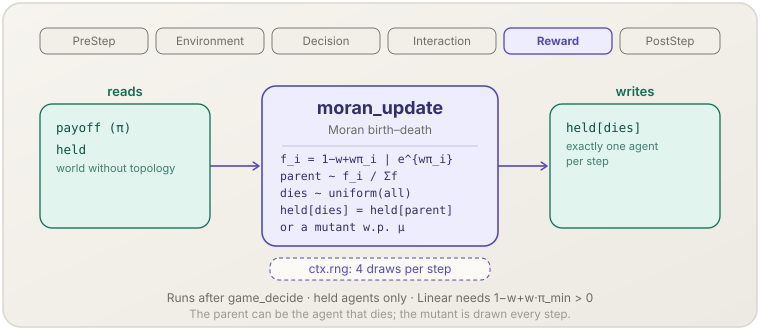

**English** | [日本語](moran-update.ja.md)

# Moran process (`moran_update`)

> One birth–death event per step: a parent chosen in proportion to fitness passes its action to one uniformly chosen agent, with optional mutation.
> **Phase:** Reward. **Source:** Moran (1958); Nowak, Sasaki, Taylor & Fudenberg (2004). **Kind:** selection (birth–death).

[← Back to the mechanism catalog](../mechanisms.md)

## 1. Overview

`moran_update` is one of the four population dynamics of
[`socsim-games`](../games.md#population-dynamics). It is registered by
`assemble_with` when its `dynamics` argument is
`MoranUpdate::new(fitness, mutation, update)?`, and it works on a world whose
agents are all **held** and which has **no topology**. After the step has been
played it performs exactly one birth–death event:

1. maps every agent's payoff to a fitness with the configured `Fitness`;
2. draws a **parent** from all agents with probability proportional to fitness;
3. draws the agent that **dies** uniformly from all agents — the parent
   included;
4. writes the parent's held action to the dying agent's `held`, or, with
   probability `mutation`, a mutant: in a finite game an action drawn
   uniformly from the common action set, in a continuous game the parent's
   action plus independent $N(0, \sigma^2)$ noise on every component, clamped
   to the bounds.

All other agents keep their actions. Because a step changes at most one agent,
a Moran run needs on the order of $N$ steps for what imitation dynamics do in
one step.

## 2. Theory & source

The Moran process (Moran, 1958) is the standard model of selection in a finite
population of fixed size $N$; Nowak, Sasaki, Taylor & Fudenberg (2004) made it
the frequency-dependent process of evolutionary game theory, with fitness
derived from game payoffs. In the formulation of Traulsen, Shoresh & Nowak
(2008), one individual is selected proportional to fitness and produces an
identical offspring that replaces a randomly chosen individual. With $j$
agents of type $A$, the number of $A$ grows by one with probability

$$T^+(j) = \frac{j f_A}{j f_A + (N - j) f_B}\cdot\frac{N - j}{N}$$

— the factor $(N - j)/N$ shows that the dying agent is drawn from all $N$
agents, the parent included. Fitness is a function of the step payoff $\pi$:

$$\texttt{Linear}\ \{w\}:\ f = 1 - w + w\,\pi \quad (w \in [0, 1]), \qquad \texttt{Exponential}\ \{w\}:\ f = e^{w\pi}$$

$w = 0$ is neutral drift; with `Linear` and $w = 1$ fitness equals payoff. The
probability that a single mutant takes over the population is

$$\rho_A = \frac{1}{1 + \sum_{k=1}^{N-1} \prod_{j=1}^{k} f_B(j)/f_A(j)}$$

which for constant fitness $f_A = r$, $f_B = 1$ is
$\rho = (1 - 1/r)/(1 - 1/r^N)$, and $1/N$ when neutral.

## 3. Data flow



Reads the step's payoffs and the held actions. Draws four values per step from
the step RNG. Writes one held action.

## 4. Position in the 6-phase loop

Registers **Reward**, after `game_decide` (so after any learning). The
payoffs it reads were written in Interaction by `game_play`; at PostStep
`world.held()` already contains the replacement while `world.payoffs()`
describes the step just played (see
[What `PostStep` sees](../games.md#what-poststep-sees)).

## 5. State read/write contract

| Field | Read | Write | Notes |
|---|:--:|:--:|---|
| `GameWorld.payoff` | ✓ | | Mapped to fitness; a non-finite payoff, a negative or non-finite fitness, or a non-positive total fitness stops the step. |
| `GameWorld.held` | ✓ | ✓ | Exactly one entry is written per step, after parent and dying agent are drawn from the pre-update state. |
| `GameWorld.topology` | | | Must be `Topology::None` (checked at assembly). |
| `PolicyTable.slot` | ✓ | | Checked once at assembly: every agent must be held. |

## 6. Dependencies & ordering constraints

- **Upstream:** `game_play` (Interaction) must have written this step's
  payoffs. The usual matchings are `RandomPairs`, `RandomGroups` and
  `WholePopulation`.
- **No topology:** `assemble_with` rejects a world with a grid or network
  (`GameError::Population`).
- **Positive linear fitness:** with `Fitness::Linear { w }`,
  $1 - w + w\,\pi_{\min}$ must be positive at the lowest attainable per-step
  payoff. This needs a bounded payoff range — `Pairwise::new(NormalFormOutcome)`
  or `counting_play()`, and under `PayoffAggregation::Sum` a matching that
  reports `encounter_bounds` (see
  [Conditions checked at assembly](../games.md#conditions-checked-at-assembly)).
  `Fitness::Exponential` needs no such check.
- **Held agents only** and a **common action space**, as for every dynamic
  (`GameError::Population`).
- **Continuous games:** a `ContinuousGame` works with `Fitness::Exponential`
  only — `Fitness::Linear` needs the payoff range over every action profile,
  which cannot be enumerated, and is rejected with `GameError::Population`.
  With `mutation > 0` the Gaussian width must be set with
  `gaussian_mutation(sd)`; a width set for a finite game is rejected too. See
  [Population dynamics with continuous actions](../games.md#population-dynamics-with-continuous-actions).

## 7. Parameters

| Parameter | Default | Kind | Notes |
|---|---|---|---|
| `fitness: Fitness` | — (required) | tunable | `Linear { w }` with `w` in `[0, 1]`, or `Exponential { w }` with finite `w`; otherwise `MoranUpdate::new` returns `GameError::Population`. `w` is the intensity of selection. |
| `mutation: f64` | — (required) | tunable | Probability in `[0, 1]` that the offspring takes a mutant instead of the parent's action (a uniformly drawn action in a finite game, which may coincide with the parent's; a Gaussian perturbation of the parent's action in a continuous game). `0` gives absorbing monomorphic states. |
| `gaussian_mutation(sd)` | unset | tunable | Continuous games only: the standard deviation $\sigma$ of the Gaussian mutation, the same for every component; finite and `> 0`, else `GameError::Population`. Required when `mutation > 0`; `gaussian_sd()` returns it. |
| `update: Update` | — (required) | structural | `Update::Synchronous`, the only schedule; it has no default. |

## 8. How to apply

Library-only. Pass the configuration as the `dynamics` argument of
`assemble_with`, on a world without topology:

### Library mode

```rust
use socsim_games::{
    assemble_with, Fitness, MoranUpdate, NormalFormOutcome, Pairwise, PlayOptions, RandomPairs,
    Update,
};

// Action 1 is a mutant with constant fitness 2 against 1 for action 0.
let game = MatrixGame::bimatrix(
    &[vec![1.0, 1.0], vec![2.0, 2.0]],
    &[vec![1.0, 2.0], vec![1.0, 2.0]],
)?;
let world = build_world(game, 10, (), InitialActions::PerAgent(one_mutant), &rules, &held, 1, 2_000, seed)?;
let mut sim = assemble_with(
    world,
    RandomPairs::new(),                                    // 10 agents: one encounter each
    rules,                                                 // an empty RuleBook: every agent is held
    Pairwise::new(NormalFormOutcome),
    MoranUpdate::new(Fitness::Linear { w: 1.0 }, 0.0, Update::Synchronous)?,
    PlayOptions::new(),
    seed,
)?
.build();
// Step until held() is all 0 (extinction) or all 1 (fixation).
```

## 9. Determinism & RNG

Draws from the engine stream (`derive_seed(seed, &[1])`, the step RNG), four
values per step, in this order: one uniform `f64` for the parent (a walk over
the cumulative fitness in `AgentId` order), one `gen_range` for the dying
agent, one uniform `f64` for the mutation decision, and one uniform action for
the mutant — drawn every step, even when no mutation happens, so the number of
draws does not depend on the outcome. In a continuous game the mutant takes
two uniform `f64` per component instead (a Box–Muller transform), likewise
drawn every step, even without a width set. The mechanism keeps no state between
steps, so a snapshot resumes it exactly.

## 10. Expected behaviour

With $N = 10$, `RandomPairs` (every agent plays exactly once, so `Sum` and
`Mean` agree), `Fitness::Linear { w: 1.0 }`, no mutation and one initial
mutant, the frequency with which the mutant takes over matches $\rho$:

| Game | $\rho$ | Fixations observed |
|---|---|---|
| neutral, $A = \begin{pmatrix}1 & 1\\ 1 & 1\end{pmatrix}$ | $1/10$ | 4 016 of 40 000 runs |
| constant fitness $r = 2$, $A = \begin{pmatrix}1 & 1\\ 2 & 2\end{pmatrix}$ | $512/1023 \approx 0.5005$ | 4 040 of 8 000 runs |

Both counts lie inside the acceptance regions of an exact binomial test
($[3793, 4210]$ and $[3848, 4160]$). Absorption takes about 28 and 35 steps
on average.

## 11. References

- Moran, P. A. P. (1958). Random processes in genetics. *Mathematical Proceedings of the Cambridge Philosophical Society*, 54(1), 60–71.
- Nowak, M. A., Sasaki, A., Taylor, C., & Fudenberg, D. (2004). Emergence of cooperation and evolutionary stability in finite populations. *Nature*, 428(6983), 646–650.
- Traulsen, A., Shoresh, N., & Nowak, M. A. (2008). Analytical results for individual and group selection of any intensity. *Bulletin of Mathematical Biology*, 70(5), 1410–1424.
