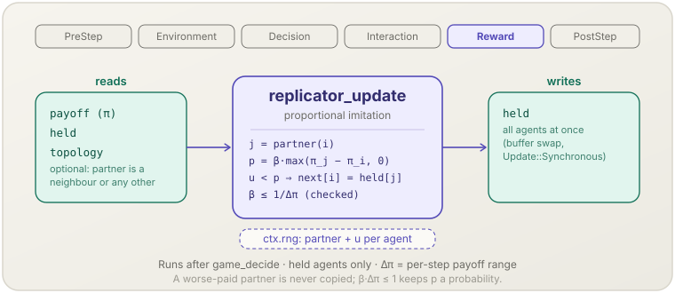

[English](replicator-update.md) | **日本語**

# 比例模倣（`replicator_update`）

> Held の各エージェントが無作為な相手 1 人と自分を比べ，より稼いだ相手を利得の差に比例した確率で写します．全員が一斉に更新します．
> **フェーズ：** Reward．**出典：** Schlag（1998）．**種別：** stochastic imitation．

[← Mechanism カタログに戻る](../mechanisms.ja.md)

## 1. 概要

`replicator_update` は [`socsim-games`](../games.ja.md#集団動学) の 4 つの集団動学の 1 つです．
`assemble_with` の引数 `dynamics` に `ProportionalImitation::new(beta, update)?` を渡すと登録され，全エージェントが **Held** の World で動きます．
ステップの対戦が終わった後，各エージェント $i$ は次を行います．

1. 比較の相手 $j$ を 1 人引きます．トポロジーの近傍から，トポロジーの無い World ではほかの全エージェントから一様に引きます．
2. 確率 $\beta\,[\pi_j - \pi_i]_+$ で $j$ の保持行動を採ります．$j$ の稼ぎが少なければ決して採りません．
3. 全エージェントについて一斉に，結果を `held` に書きます．

名前は，この規則が近似する動学から来ています．大きなよく混ざった集団では，この規則のもとでの行動の割合の期待変化はレプリケータ動学の離散版になります．

## 2. 理論と出典

Schlag（1998）は，ほかのエージェントを 1 人観察する限定合理的なエージェントの，改善をもたらす模倣規則として比例模倣を導きました．
観察した行動のほうがどれだけ良かったかに比例した確率で，その行動に切り替えます．

$$P(i \leftarrow j) = \beta\,\big[\pi_j - \pi_i\big]_+ ,\qquad [x]_+ = \max(x, 0)$$

- $\pi_i$ — そのステップのエージェント $i$ の利得（`world.payoffs()`．`PayoffAggregation` の後）．
- $\beta > 0$ — 模倣の率．

このとき行動 $k$ の割合 $x_k$ の期待値は $x_k\,(\bar\pi_k - \bar\pi)$ に比例して変わります．離散時間の Taylor & Jonker（1978）のレプリケータ方程式です．
どの利得の組でも確率が 1 以下に収まるには，$\beta$ が次を満たさなければなりません．

$$\beta \le \frac{1}{\Delta\pi}$$

$\Delta\pi$ は，**1 ステップに**取りうる利得の値域の幅です．
`assemble_with` が $\Delta\pi$ を求め，それより大きな $\beta$ を拒否します（[組み立て時の検査](../games.ja.md#組み立て時の検査) を参照）．
実行時にも確率は 1 で頭打ちにします．

## 3. データフロー



そのステップの利得，保持行動，トポロジーがあればその近傍の一覧を読みます．
ステップの RNG から，エージェントごとに相手と一様乱数を 1 つずつ引きます．
保持行動を書きます．全エージェントを評価し終えてから一時バッファと入れ替えます．

## 4. 6フェーズループにおける位置

**Reward** に，`game_decide` の後（したがって学習の後）に登録されます．読む利得は Interaction で `game_play` が書いたものです．
PostStep では，`world.held()` は次のステップの行動を持ち，`world.payoffs()` は打ったばかりのステップを表します
（[`PostStep` で見えるもの](../games.ja.md#poststep-で見えるもの) を参照）．

## 5. 状態の読み書きコントラクト

| フィールド | 読み | 書き | 備考 |
|---|:--:|:--:|---|
| `GameWorld.payoff` | ✓ | | エージェントごとに 1 つ．有限でない利得はステップを止める． |
| `GameWorld.held` | ✓ | ✓ | 次の行動はすべて更新前の `held` から計算し，一斉に書く（`Update::Synchronous`）． |
| `GameWorld.topology` | ✓ | | 相手は近傍（有向ネットワークでは出近傍）．`Topology::None` ではほかの任意のエージェント． |
| `PolicyTable.slot` | ✓ | | 組み立て時に 1 回検査する．全エージェントが Held でなければならない． |

## 6. 依存関係と順序制約

- **上流：** `game_play`（Interaction）がそのステップの利得を書いていること．
- **有界な利得の値域：** 評価経路は `Pairwise::new(NormalFormOutcome)`（すべての行動の組から値域を求める．10⁶ 以下）か `counting_play()`（すべての人数ベクトルから求める）でなければなりません．
  利用者定義の `OutcomeRule` では値域が求まらないので拒否されます．
- **`Sum` での対戦の数：** `PayoffAggregation::Sum` では，Matching が `encounter_bounds` を報告しなければなりません
  （集団用の Matching はどれも報告し，`FixedPlayers`，`RoundRobin`，既定のままの独自の Matching は報告しません）．報告しない Matching では `PayoffAggregation::Mean` を使ってください．
- **Held のエージェントだけ**と**共通の行動の集合**は，ほかの動学と同じです（`GameError::Population`）．
- **下流：** 次のステップは新しい保持行動で対戦します．
  `MetricsOptions::population_share(true)` の [`game_metrics`](game-metrics.ja.md) が更新後の割合を記録します．

## 7. パラメータ

| パラメータ | 既定 | 種別 | 備考 |
|---|---|---|---|
| `beta: f64` | —（必須） | tunable | 模倣の率 $\beta$．`ProportionalImitation::new` は有限かつ `> 0` を求め，`assemble_with` は $\beta \le 1/\Delta\pi$ を求める（`GameError::Population`）． |
| `update: Update` | —（必須） | structural | `Update::Synchronous`．方式はこれだけで，既定値は無い． |

1 回の対戦の値域 $[p_{\min}, p_{\max}]$ と Matching の `encounter_bounds` `min..max` から $\Delta\pi$ を求める方法は次のとおりです．

| 集計 | 1 ステップの値域 |
|---|---|
| `Sum` | $c \in \{\texttt{min}, \texttt{max}\}$，$p \in \{p_{\min}, p_{\max}\}$ の積 $c \cdot p$ を覆う範囲 |
| `Mean` | $[p_{\min}, p_{\max}]$ |
| どちらでも，`min = 0` のとき | 上の範囲を $0$ を含むように広げたもの |

$V = 2$，$C = 4$ のタカ・ハト（1 回の対戦で $[-1, 2]$）では，`RandomPairs` で $\Delta\pi = 3$，$\beta \le 1/3$，
自己対戦つきの Moore 近傍の格子（9 回の対戦）では `Sum` で $[-9, 18]$，$\beta \le 1/27$ です．

## 8. 適用方法

ライブラリ専用です．`assemble_with` の引数 `dynamics` に設定を渡します．

### ライブラリモード

```rust
use socsim_games::catalog::HawkDove;
use socsim_games::{
    assemble_with, NormalFormOutcome, Pairwise, PlayOptions, ProportionalImitation, RandomPairs,
    Update,
};

let game = HawkDove::new(2.0, 4.0)?;                       // one encounter pays in [-1, 2]
let world = build_world(game, n, (), initial, &rules, &held, 1, steps, seed)?;
let mut sim = assemble_with(
    world,
    RandomPairs::new(),
    rules,                                                 // an empty RuleBook: every agent is held
    Pairwise::new(NormalFormOutcome),
    ProportionalImitation::new(1.0 / 3.0, Update::Synchronous)?, // beta = 1 / 3
    PlayOptions::new(),
    seed,
)?
.build();
```

完全なプログラムは [`docs/games.ja.md` の「集団動学」](../games.ja.md#集団動学) のタカ・ハトの例と，`crates/socsim-games/examples/hawk_dove_large.rs` です．

## 9. 決定論性と RNG

エンジンのストリーム（`derive_seed(seed, &[1])`，ステップの RNG）から引きます．
エージェントを `AgentId` の昇順に訪れ，各自が `gen_range` で相手を 1 人，続いて一様な `f64` を 1 つ引き，
その値が $\min(1, \beta\,[\pi_j - \pi_i]_+)$ より小さければ相手の行動を採ります．近傍を持たないエージェントは何も引きません．
ステップの間に状態を持たないので，snapshot から正確に再開できます．

## 10. 期待される動作

$V = 2$，$C = 4$，`RandomPairs`，$\beta = 1/3$ のよく混ざったタカ・ハトでは，次のようになります．

- タカの割合は進化的に安定な割合 $V/C = 0.5$ へ向かい，その周りで揺れます．
  $N = 10^4$，初期のタカ 30 %，seed 20 本で，ステップ 201〜1000 の `game.population_share.a0` の seed ごとの平均の 95 % $t$ 区間は $[0.45, 0.55]$ の内側に入ります（seed 間の平均は 0.49986）．
- $10^6$ 人で 0.5 から始めた `hawk_dove_large` は，10 ステップ後にタカの割合 0.499876 で終わります．
- $\beta = 0.5$ を求めると，組み立て時に `replicator_update requires beta <= 1 / 3 (the per-step payoff range), got 0.5` で失敗します．

## 11. 参考文献

- Schlag, K. H. (1998). Why imitate, and if so, how? A boundedly rational approach to multi-armed bandits. *Journal of Economic Theory*, 78(1), 130–156.
- Taylor, P. D., & Jonker, L. B. (1978). Evolutionary stable strategies and game dynamics. *Mathematical Biosciences*, 40(1–2), 145–156.
