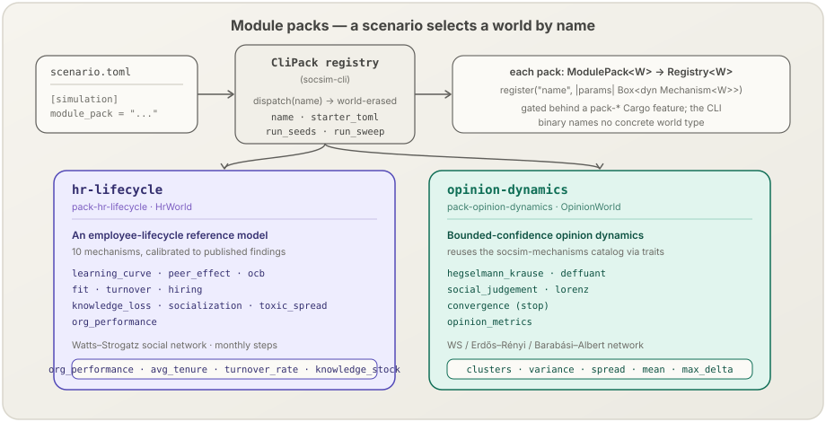

[English](packs.md) | **日本語**

# モジュールパックカタログ

**モジュールパック**は，socsim における*完結したモデル*の単位です．
[メカニズム](mechanisms.ja.md)が研究ロジックの1つの部品であるのに対し，パックはワールド全体を実行するために必要なものをすべて束ねます．具体的には，すべてのエージェントが共有する状態を表す具体的な**ワールド型**，それを前進させる**メカニズム**群，それらのメカニズムを名前で [`Registry`](library.ja.md) に組み込む**登録**関数，そしてすぐに実行できる**スターターシナリオ** TOML です．

`socsim` CLI は**ワールド多相**です．シナリオが名前でパックを選択し（`[simulation] module_pack = "..."`），バイナリは具体的なワールドを一切名指しすることなく，そのパックのワールド型へディスパッチします．現在4つのパックが同梱されています．



## 同梱される4つのパック

| パック | ワールド | モデル化対象 | メカニズム | ページ |
|---|---|---|---|---|
| [`hr-lifecycle`](packs/hr-lifecycle.ja.md) | `HrWorld` | 従業員ライフサイクル組織：採用，学習，ピア効果，満足度，離職カスケード，知識喪失 | 10個，公表された経験的知見に対してキャリブレーション済み | [→ hr-lifecycle](packs/hr-lifecycle.ja.md) |
| [`opinion-dynamics`](packs/opinion-dynamics.ja.md) | `OpinionWorld` | ソーシャルネットワーク上の有界信頼の意見形成（合意，クラスタリング，分極化） | `socsim-mechanisms` の意見ファミリーを，ケイパビリティトレイト経由で再利用 | [→ opinion-dynamics](packs/opinion-dynamics.ja.md) |
| [`organizational-silence`](packs/organizational-silence.ja.md) | `SilenceWorld` | スモールワールドネットワーク上の階層型従業員：異質な沈黙動機，恐怖，心理的安全性，上司の開放性，報復イベント，閾値カスケード | 10個（加えて LLM 変種），組織行動研究の知見に対してキャリブレーション済み | [→ organizational-silence](packs/organizational-silence.ja.md) |
| [`normal-form`](packs/normal-form.ja.md) | `GameWorld`（有限か連続かを `[world.game] kind` で選ぶ） | 戦略形（標準形）ゲーム：決定規則に従うエージェントどうしの繰り返し対戦，格子やネットワーク上の集団動学，連続行動の寡占 — すべてをシナリオだけで構成する | [`socsim-games`](games.ja.md) の8つのメカニズム（`game_match`，`game_decide`，`game_play`，集団動学4つ，`game_metrics`） | [→ normal-form](packs/normal-form.ja.md) |

CLI からはいつでも一覧表示できます．

```sh
socsim list packs        # pack names
socsim list mechanisms   # mechanisms grouped by pack
```

## パックの構造

すべてのパックは2つのトレイトとスターター TOML によって定義されます．

1. **`ModulePack<W>`**（[`socsim-config`](library.ja.md)）— 研究者向けのインターフェースです．`pack_name()` と `register(&mut Registry<W>)` メソッドを持ち，すべてのメカニズムコンストラクタを名前で追加します．ライブラリ利用者はこれを直接呼び出すことで，1行でひとまとまりの研究内容を有効化できます．

2. **`CliPack`**（[`socsim-cli`](cli.ja.md)）— オブジェクトセーフで*ワールド消去された*ラッパーです．`name()`，`starter_toml()`，`mechanism_names()`，`run_seeds()`，`run_sweep()` を公開し，いずれもワールド非依存の結果型を返します．さらに `socsim sweep` が呼ぶ `run_sweep_rows()` があります．これは `run_sweep()` を包む既定実装を持つので（各 `SweepPoint` を実効シナリオの無い `SweepRow` にする），pack が上書きするのは組合せごとの書き換え後のシナリオを返せるときだけです．各 `CliPack` は内部に具体的なワールドを保持し，ジェネリックな [`socsim-runner`](architecture.ja.md) 関数をそれに対して単態化するため，CLI バイナリは特定のドメインモデルから独立し続けます．さらに pack 固有の規則を検査する `validate()` を持ちます．既定の実装はすべてを受け入れ，`socsim` は `validate`・`run`・`sweep` のいずれでも，汎用のシナリオ検査の後にこれを呼びます（[CLI リファレンス § validate](cli.ja.md#validate) を参照）．

**`Registry` を使わないパック．** `normal-form` パックは `ModulePack<W>` の形に乗りません．`ModulePack` を実装せず，何も登録しません．`NormalFormPack` は `[world.game] kind` を読んで有限ゲームか連続ゲームかを選び，**シナリオ全体**を `socsim-games` の試行ファクトリ（`GameTrialFactory`）に渡します．ワールド，集団，Matching，規則，集団動学，指標はすべてシナリオから作られます（[戦略形ゲーム § Scenario ファイル](games.ja.md#scenario-ファイル)を参照）．そのため，この pack の `CliPack` は `validate()` でシナリオ全体（すべてのキー，すべての組合せ，1回の乾いた構築）を検査し，試行と検証付きスイープを `socsim_runner::run_trials` / `run_trial_sweep` で走らせます．スイープで `world.` のパスを書き換えられ，組合せごとの実効シナリオが返るのはこのためです．

同梱の全パックは同名の Cargo フィーチャ（`pack-hr-lifecycle`，`pack-opinion-dynamics`，`pack-organizational-silence`，`pack-normal-form`）でゲートされており，いずれもデフォルトで有効です．そのため，下流のバイナリは必要なパックだけをコンパイルに含められます．`organizational-silence` パックは加えて `pack-organizational-silence-llm` フィーチャを提供し，これを有効にするとルールベースの `voice_decision_rule` と並んで LLM 駆動の `voice_decision` メカニズムが追加されます．パック層がシナリオとエンジンの間にどう位置するかは[アーキテクチャ概要](architecture.ja.md#2つの利用経路シナリオcli-vs-ライブラリモード)を，パックをゼロから組み立てる実践的な手順は [T5 — シナリオパック](tutorials/05-scenario-pack.ja.md)チュートリアルを参照してください．

## パックを駆動する2つの方法

| 経路 | エントリポイント | 適した用途 |
|---|---|---|
| **シナリオ / CLI** | `.toml` 内の `module_pack = "..."`，続けて `socsim run` | 再現可能なシナリオファイル，パラメータスイープ，再コンパイル不要 |
| **ライブラリ** | Rust での `Pack.register(&mut reg)` + `SimulationBuilder` | カスタムドライバ，socsim をより大きなプログラムへ組み込む |

`normal-form` のライブラリの経路は `register` ではなく，`NormalFormPack`（CLI と同じ入口）か `socsim-games` のビルダーです．

以下の各パックページでは，両方の経路，ワールドのデータモデル，[6フェーズティックループ](architecture.ja.md#6フェーズティックループ)にまたがるメカニズムの構成，スターターシナリオ，記録されるメトリクスを解説します．

## ページ

- [**hr-lifecycle**](packs/hr-lifecycle.ja.md) — キャリブレーション済みの従業員ライフサイクル参照モジュール（`HrWorld`，10個のメカニズム）．
- [**opinion-dynamics**](packs/opinion-dynamics.ja.md) — 有界信頼の意見ダイナミクス（`OpinionWorld`）．
- [**organizational-silence**](packs/organizational-silence.ja.md) — 階層型ネットワーク上の沈黙の風土の創発（`SilenceWorld`，10個のルールベースメカニズム＋オプションの LLM 変種）．
- [**normal-form**](packs/normal-form.ja.md) — シナリオだけから組み立てる戦略形ゲームのシミュレーション（`GameWorld`，`socsim-games` の8つのメカニズム，有限ゲームと連続ゲーム）．

## 新しいパックを追加する

CLI レジストリは，run/sweep/validate/list パイプラインに手を加えることなく，新しいパックが既存の4つと並んで収まるよう設計されています．

1. 具体的な `World` とそのメカニズムを実装する（あるいは，意見パックのように，ケイパビリティトレイト経由で [`socsim-mechanisms`](mechanisms.ja.md) カタログを再利用する）．
2. それに対して `ModulePack<W>` を実装する（`pack_name` + `register`）．
3. `pack-foo` Cargo フィーチャの背後で，`CliPack` を実装した `struct FooCliPack;` を実装する．汎用の検査（メカニズム名，スケジューラー，`t_max`）では見えない規則がパックにあれば `validate()` を上書きする．
4. `crates/socsim-cli/src/packs.rs` の `packs()` にそれを追加する．

`normal-form` のように試行をシナリオ全体から組み立てるパックはステップ2を省きます．`socsim_runner::TrialFactory` を実装し（あるいは既存のものを使い），`CliPack` から `run_trials` / `run_trial_sweep` を呼びます．

[T5 チュートリアル](tutorials/05-scenario-pack.ja.md)が，ステップ1–2をエンドツーエンドで解説します．

## 関連項目

- [Mechanism カタログ](mechanisms.ja.md) — パックが構成する個々のメカニズム．
- [CLI リファレンス](cli.ja.md) — `init`，`run`，`validate`，`list`，`sweep`，`summarize`．
- [アーキテクチャ](architecture.ja.md) — クレートグラフ，6フェーズティックループ，キャリブレーション哲学．
- [ユースケース＆レシピ](usecases.ja.md) — 各同梱パックの実行可能なワークフロー．
