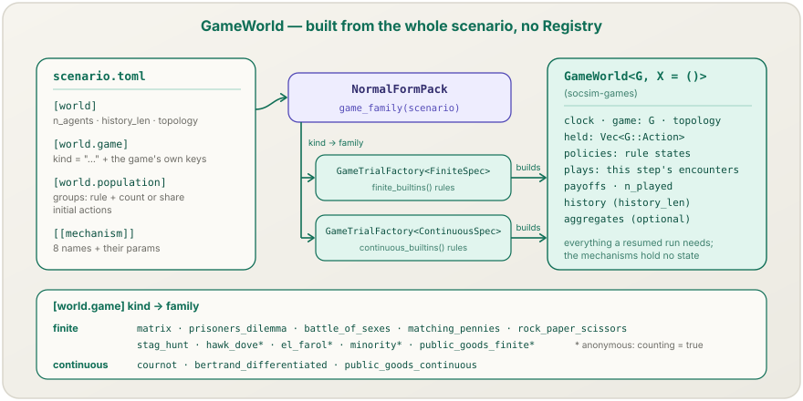
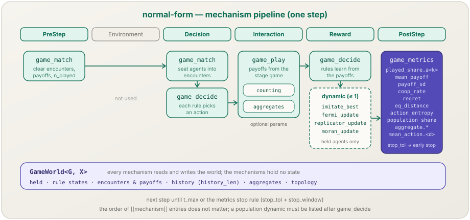

**English** | [日本語](normal-form.ja.md)

# `normal-form` pack

> **Normal-form (strategic-form) game simulations** built from a scenario file alone: a stage game, a population of rule-driven or held agents, a matching protocol, payoffs, an optional population dynamic and per-step game metrics — repeated prisoner's dilemmas, spatial games on lattices and networks, and continuous-action oligopolies, without writing Rust.
> **World:** `GameWorld<FiniteSpec>` or `GameWorld<ContinuousSpec>`, chosen by `[world.game] kind`. **Mechanisms:** eight [`socsim-games`](../games.md) mechanisms plus the generic `continuation_probability` mechanism. **Cargo feature:** `pack-normal-form` (on by default).

[← Back to the pack catalog](../packs.md)

## 1. Overview

The `normal-form` pack exposes the [`socsim-games`](../games.md) crate to the
`socsim` binary. Every step, agents are seated into encounters by a matching,
choose actions with their decision rules (tit for tat, fictitious play, logit
choice, Roth–Erev, repeated-game automata, damped best response, …) or keep
their held action, receive the stage game's payoffs, learn, and — when a
population dynamic is listed — imitate or replace one another. The game, the
population, the topology and every rule parameter are read from the scenario.

Unlike the other three packs, this one has **no `Registry`** and implements no
`ModulePack`. `NormalFormPack` reads `[world.game] kind`, picks the finite or
the continuous trial factory of `socsim-games` (`GameTrialFactory<FiniteSpec>`
or `GameTrialFactory<ContinuousSpec>`, with the built-in rules), and hands it
the whole scenario. The game part builds through the same procedure as the
library-mode builder `GameSimFactory`, so a scenario and the same game configuration
written in Rust give the same world and the same metric rows at every step. An
optional `continuation_probability` is appended afterwards, as it would be by
adding the generic mechanism to the library-mode builder.
The full key reference is
[normal-form games § Scenario files](../games.md#scenario-files); this page
covers what the pack adds on top of it.

Three scenarios ship with the pack:

| File | Game | What it shows |
|---|---|---|
| `scenarios/normal_form_ipd.toml` (also the `socsim init` starter) | repeated prisoner's dilemma, 2 agents | tit for tat against fictitious play, Nash-distance and regret columns |
| `scenarios/normal_form_nowak_may.toml` | spatial prisoner's dilemma on a 100 × 100 toroidal Moore lattice | Nowak–May imitate-the-best dynamics of held agents, `b = 1.85` |
| `scenarios/normal_form_cournot.toml` | Cournot oligopoly, 3 firms | damped best responses converging to `q* = 22.5`, aggregates and early stopping |

## 2. The world: `GameWorld`



`[world.game] kind` selects the game family, and with it the world type, the
rules that may be named and the metrics that are recorded:

| Family | `kind` | Actions | Built-in rules (`rule = ...`) |
|---|---|---|---|
| finite | `matrix`, `prisoners_dilemma`, `battle_of_sexes`, `matching_pennies`, `rock_paper_scissors`, `stag_hunt`, `hawk_dove`, `el_farol`, `minority`, `public_goods_finite` | action indices with ASCII labels | `uniform_random`, `tit_for_tat`, `myopic_best_response`, `fictitious_play`, `logit`, `roth_erev`, `all_c`, `all_d`, `grim`, `wsls`, `gtft` |
| continuous | `cournot`, `bertrand_differentiated`, `public_goods_continuous` | vectors in a box | `damped_best_response`, `gradient` |

Every family also accepts `rule = "held"` for agents that only keep their
current action (the agents a population dynamic acts on). A rule of the other
family is an unknown rule.

`GameWorld` keeps every piece of state a resumed run needs — the held actions,
each agent's rule state, this step's encounters and payoffs, the per-agent
history ring of `history_len` steps, the matching state, the topology and the
aggregate table. The mechanisms are code only. See
[normal-form games § Where rule state lives](../games.md#where-rule-state-lives-and-why-it-matters-for-snapshots).

The scenario fills it in four places:

- **`[world]`** — `n_agents` (left out on a grid), `history_len`, and the
  topology: `"none"` (default), `"grid"` (`grid_rows`, `grid_cols`,
  `boundary`, `neighborhood`) or `"network"` (`network_model` and its
  parameters).
- **`[world.game]`** — `kind` and the game's own keys (`temptation`, `reward`,
  `punishment`, `sucker` for the prisoner's dilemma; `labels` and `payoffs`
  for a matrix; `a`, `b`, `c`, `q_max` for Cournot; …). Games whose players are
  `n_agents` (`el_farol`, `minority`, `cournot`, `bertrand_differentiated`)
  take the count from `[world]`.
- **`[world.population]`** — one `[[world.population.group]]` per rule, each
  with `count` or `share`, laid out in the listed order (`assign = "ordered"`)
  or shuffled; and the initial actions (`initial_shares`, `initial_action`, or
  `initial_uniform` for continuous games).
- **`[[mechanism]]`** — one entry per mechanism, with its parameters in
  `[mechanism.params]` (next section).

## 3. Mechanisms in the pack

`socsim list mechanisms` shows the nine names the pack accepts:

| Mechanism | Phase | Behaviour | Required | Page |
|---|---|---|---|---|
| `game_match` | PreStep, Decision | Clears the step, then seats agents into encounters (`matching = "fixed_players"`, `"round_robin"`, `"random_pairs"`, `"random_groups"`, `"whole_population"`, `"grid_neighborhood"`, `"network_edges"`) | yes | [→](../mechanisms/game-match.md) |
| `game_decide` | Decision, Reward | Each rule-driven agent chooses an action; after play, the rules learn. Holds the rule parameters (`coop_label`, `logit_lambda`, `br_damping`, …) | yes | [→](../mechanisms/game-decide.md) |
| `game_play` | Interaction | Evaluates the encounters and writes payoffs; optionally records the game's aggregates (`aggregate_history_len`) or uses the counting path (`counting`) | yes | [→](../mechanisms/game-play.md) |
| `imitate_best` | Reward | Held agents copy the best-earning action among themselves and their neighbours | at most one dynamic | [→](../mechanisms/imitate-best.md) |
| `fermi_update` | Reward | Pairwise comparison with the Fermi rule, noise `k` | at most one dynamic | [→](../mechanisms/fermi-update.md) |
| `replicator_update` | Reward | Proportional imitation with coefficient `beta` (finite games) | at most one dynamic | [→](../mechanisms/replicator-update.md) |
| `moran_update` | Reward | One birth–death event per step, fitness `"linear"` or `"exponential"` | at most one dynamic | [→](../mechanisms/moran-update.md) |
| `game_metrics` | PostStep | Records the per-step game metrics (§4) | optional | [→](../mechanisms/game-metrics.md) |
| `continuation_probability` | PostStep | Continues after a completed step with probability `delta`; otherwise records `continuation_stop` and requests stop | optional | [→](../mechanisms/continuation-probability.md) |

The order of the `[[mechanism]]` entries does not change the run: the
mechanisms always run as `game_match`, `game_decide`, the dynamic,
`game_play`, `game_metrics`, `continuation_probability`. The one ordering rule is that a population
dynamic must be **listed after** `game_decide`. `phase` keys are ignored.
Population dynamics act only on held agents and take only
`update = "synchronous"`.

The pack does not offer the LLM decision rules, the `fixed` and `mixed`
rules, custom games, outcome rules or matchings; those need
[library mode](../games.md).

## 4. The pipeline & metrics



`game_metrics` records one row per step. Which columns appear depends on the
game and the options; a column that is undefined for the run is left out,
never written as NaN.

| Family | Metric | Meaning |
|---|---|---|
| finite | `game.played_share.a<k>` | share of the step's plays that used action `k` (`a0` = the first label, e.g. `C`) |
| finite | `game.mean_payoff`, `game.payoff_sd` | mean and standard deviation of this step's payoffs |
| finite | `game.coop_rate` | share of cooperative plays (needs `cooperate_label`) |
| finite | `game.regret` | mean regret against the played mix (two-role games by default; `regret = false` turns it off) |
| finite | `game.eq_distance` | distance to a Nash equilibrium (`equilibrium = "solve"`, two-role games) |
| finite | `game.action_entropy` | entropy of the played actions |
| finite | `game.population_share.a<k>` | share of agents holding action `k` (`population_share = true`) |
| both | `game.aggregate.<name>` | the game's public aggregates (`aggregate_history_len` in `game_play`), e.g. `price` and `total_output` for Cournot |
| continuous | `game.mean_action.<d>`, `game.action_sd.<d>` | mean and standard deviation of action component `d` |
| continuous | `game.eq_distance`, `game.mean_payoff`, `game.payoff_sd` | distance to the best-response-iteration equilibrium (`equilibrium = "solve"`), payoff statistics |

With `stop_tol` and `stop_window`, `game_metrics` also ends the run early once
the actions stop changing (Cournot stops at step 90 of 500). The exact
definitions are on the [`game_metrics` page](../mechanisms/game-metrics.md).

**`[output] metrics` selects CLI columns.** When the list is non-empty, the
single-seed series, multi-seed summary, and sweep table/CSV contain only those
keys, in the written order; duplicates use their first occurrence. JSONL logs
still contain every recorded metric. An empty or omitted list preserves the
all-metric output. `normal-form` rejects keys that match none of the configured
`game_metrics` patterns before execution; every pack also rejects a requested
key that appears in no result after execution (after run JSONL logs have been
written). Thus a concrete but absent action such as `game.played_share.a9`
passes pattern validation and then fails against the recorded keys.

The game mechanisms emit no events by default (`Seed 42 — 0 events recorded`).
When `continuation_probability` stops a run, it emits one `continuation_stop`
event at the stopping step, with `delta` and the uniform draw `u` in the payload.

### The counting path: `counting`

For an **anonymous** game — `hawk_dove`, `el_farol`, `minority`,
`public_goods_finite` — a payoff depends only on one's own action and the
counts of the others' actions. `counting = true` in `game_play` evaluates
encounters from those counts instead of profile by profile:

```toml
[[mechanism]]
name = "game_play"
[mechanism.params]
counting = true
```

The payoffs, the metrics and the world are the same as with
`counting = false`; only the work per encounter changes. It combines with
`materialize` and `aggregate_history_len`. It is rejected for the other finite
games and for continuous games (even `counting = false`):

```text
mechanism[game_play].counting: counting play requires an anonymous game
mechanism[game_play].counting: counting play requires a finite game
```

## 5. How to apply

### Scenario / CLI

```sh
socsim init --module-pack normal-form --out scenarios/ipd.toml
socsim validate scenarios/ipd.toml
socsim run scenarios/ipd.toml
```

The starter (identical to `scenarios/normal_form_ipd.toml`) pits tit for tat
against fictitious play in a repeated prisoner's dilemma:

```toml
[simulation]
name        = "ipd_tft_vs_fp"
module_pack = "normal-form"
t_max       = 200
seed        = 42
scheduler   = "sequential"

[world]
n_agents    = 2
history_len = 200

[world.game]
kind    = "matrix"
labels  = [["C", "D"], ["C", "D"]]
payoffs = [
  [[3.0, 3.0], [0.0, 5.0]],
  [[5.0, 0.0], [1.0, 1.0]],
]

[world.population]
assign = "ordered"                            # Assign to AgentId 0, 1, ... in group order.
[[world.population.group]]
rule  = "tit_for_tat"
count = 1
[[world.population.group]]
rule  = "fictitious_play"
count = 1

[[mechanism]]
name = "game_match"
[mechanism.params]
matching = "fixed_players"
pairs    = [[0, 1]]

[[mechanism]]
name = "game_decide"
[mechanism.params]
decision_scope = "per_step"
coop_label     = "C"                          # Cooperative action for automata.
fp_tie_break   = "lowest_index"

[[mechanism]]
name = "game_play"
[mechanism.params]
payoff_aggregation = "sum"

[[mechanism]]
name = "game_metrics"
[mechanism.params]
cooperate_label = "C"
equilibrium     = "solve"                     # Solve the small game for Nash-equilibrium distance.

[output]
log_path = "runs/{name}_{seed}.jsonl"
metrics  = ["game.mean_payoff", "game.played_share.a0", "game.regret"]   # a0 is action 0, labelled C.
```

```
Running 'ipd_tft_vs_fp' (pack=normal-form, t_max=200, seeds=[42], parallel=false)

Seed 42 — 0 events recorded

t       game.action_entropy    game.coop_rate  game.eq_distance  game.mean_payoff    game.payoff_sd  game.played_share.a0  game.played_share.a1       game.regret
10                0.0000            0.0000            0.0000            1.0000            0.0000            0.0000            1.0000            0.0000
20                0.0000            0.0000            0.0000            1.0000            0.0000            0.0000            1.0000            0.0000
...
200               0.0000            0.0000            0.0000            1.0000            0.0000            0.0000            1.0000            0.0000
```

Fictitious play best-responds to the empirical frequency of its opponent, and
in a one-shot prisoner's dilemma defection is the best response to any belief.
Both players cooperate at step 1 (`played_share.a0 = 1`), fictitious play
defects at step 2 and tit for tat answers from step 3 on, so from step 3 the
pair sits at the Nash equilibrium (`eq_distance = 0`, payoff 1 each).

To give the repeated game a per-round continuation probability δ, add this
optional mechanism. It runs after `game_metrics`, so the stopping round is
included in the log:

```toml
[[mechanism]]
name = "continuation_probability"
[mechanism.params]
delta = 0.9
```

`delta` is required, finite and in `[0, 1]`. The mechanism uses a private RNG
stream derived from the trial seed, so it does not shift matching, decision or
engine randomness before the stop.

The other two bundled scenarios run the same way; their output is shown on the
[use-cases page](../usecases.md#8-normal-form-games-from-a-scenario). Swap the
rules, the game or the matching by editing the scenario; the key reference is
[normal-form games § Scenario files](../games.md#scenario-files).

### Sweeps

`socsim sweep` runs the pack's checked sweep: an axis can be a `world.` path
or a `<mechanism>.<param>`, every combination is validated before any trial
runs, and each combination's effective scenario is written next to its CSV as
`combo_<i>_<label>.scenario.toml`:

```sh
socsim sweep scenarios/normal_form_nowak_may.toml \
    --param "world.game.temptation=1.6,1.7,1.8,1.9" --seeds 0..10 --parallel
```

| Axis | Meaning |
|---|---|
| `world.game.<param>` | a parameter of the built-in game (`temptation`, `v`, `c`, `a`, `r`, …); only keys written in the scenario |
| `world.population.initial_shares.<label>` | an initial share; only labels written in the scenario |
| `world.<key>` | another numeric `[world]` key, e.g. `world.history_len` (an integer key takes integral values only) |
| `game_decide.logit_lambda` | rationality $\lambda$ of the logit rule |
| `game_decide.roth_erev_phi`, `game_decide.roth_erev_epsilon` | forgetting and experimentation rates of Roth–Erev |
| `game_decide.br_damping`, `game_decide.grad_step` | damping and step size of the continuous rules |
| `fermi_update.k` | Fermi noise $K$ |
| `moran_update.w`, `moran_update.mutation` | selection strength and mutation rate |
| `replicator_update.beta` | proportional-imitation coefficient $\beta$ (its upper bound is checked again after the patch) |
| `continuation_probability.delta` | probability δ of proceeding to another step |

Strings and booleans (`kind`, `matching`, `update`, `counting`, …) cannot be
swept; write one scenario file per condition instead. Three things to know:

1. **Write a value you intend to sweep as a float.** An integer in the base
   scenario stays an integer, so `temptation = 2` swept over `1.6` fails with
   `sweep axis 'world.game.temptation': existing value is an integer; 1.6 is not an integral value representable as i64`.
   Write `temptation = 2.0`.
2. **`world.population.initial_shares.<label>` can sweep only labels written
   in the base scenario.** A label left out (it receives the rest) has no key
   to patch: `no key 'D' in [world.population.initial_shares]`.
3. **A missing mechanism parameter is added, not rejected.** Sweeping a param
   that no agent uses — `game_decide.logit_lambda` in the IPD scenario, where no
   agent follows `logit` — passes validation and changes nothing. Check that a
   rule reading the key is assigned to some agent.

A typo in a `world.` path, an unknown mechanism name or a non-numeric target
stops the sweep before any trial runs; see
[CLI reference § sweep](../cli.md#sweep) for the messages.

### What `validate` rejects

`socsim validate`, `run` and `sweep` all check the whole scenario first: every
key and type, the combination of game, rules, matching and dynamic, and one dry
build with the scenario's `seed`. The message starts with the key path or the
mechanism to fix (the CLI prints it under `validation failed for '<file>'` and
`config error: `). The combinations that are rejected:

| Combination | Example message |
|---|---|
| a finite-only rule in a continuous game, or the reverse | `world.population.group[0].rule: unknown rule "fictitious_play" (registered: damped_best_response, gradient; "held" means no rule)` |
| `replicator_update` in a continuous game | `mechanism[replicator_update]: replicator_update requires a finite game` |
| `counting = true` in a game that is not anonymous; `counting` (even `false`) in a continuous game | `mechanism[game_play].counting: counting play requires an anonymous game` |
| an automaton or `tit_for_tat` in a game with more than two actions | `mechanism[game_decide]: rule cannot be used with this game: TitForTat requires two actions for role 0, got 3` |
| `fictitious_play` (or `logit`) in a game with more than two roles | `mechanism[game_decide]: rule cannot be used with this game: learning rule requires 2 roles, but the game has 3` |
| `grid_neighborhood` without `topology = "grid"`, `network_edges` without a network | `mechanism[game_match]: invalid matching: GridNeighborhood requires a grid topology` |
| a population dynamic without `update`, or with `update = "asynchronous"` | `mechanism[imitate_best].update: expected one of "synchronous", found "asynchronous"` |
| a population dynamic with a group that has a decision rule | `mechanism[imitate_best]: invalid population dynamics: imitate_best applies only to held agents, but an active rule is assigned` |
| a population dynamic in a game whose roles have different action sets | `mechanism[imitate_best]: invalid population dynamics: every role must share one action space, but role 0 has 3 actions and role 1 has 2` |
| a population dynamic listed before `game_decide` | `mechanism[imitate_best]: a population dynamic must be listed after game_decide` |
| `decision_scope = "per_step"` with `round_robin` and three or more agents (or `both_orders = true`) | `mechanism[game_match]: invalid matching: RoundRobin assigns more than one role to an agent in a per-step decision` |
| groups mixing `count` and `share`, shares not summing to 1, `initial_shares` above 1 | `world.population.initial_shares: shares sum to 1.1, expected 1` |
| a label that is not ASCII `[A-Za-z0-9_-]+` | `world.game.labels[0][0]: "協力" is not an action label (ASCII letters, digits, '_' and '-')` |
| a built-in game's own conditions (e.g. $T > R > P \ge S$) | `world.game: catalog condition failed: T > R > P >= S` |
| `replicator_update.beta` above the payoff-range bound | `mechanism[replicator_update]: invalid population dynamics: replicator_update requires beta <= 1 / 16.650000000000002 (the per-step payoff range), got 1` |
| `moran_update` without `fitness`, or `"linear"` fitness that can turn negative | `mechanism[moran_update].fitness: this key is required` |
| missing, non-finite or out-of-range `continuation_probability.delta` | `mechanism[continuation_probability].delta: expected a continuation probability in [0, 1], found 1.1` |
| an unknown key in any mechanism's params | `mechanism[game_decide].logit_lamda: unknown key (known keys: …)` |
| an unknown mechanism name | `mechanism 'game_decid' is not registered in the 'normal-form' pack; available: [fermi_update, game_decide, …]` |

The checks run on `scenario.simulation.seed`; a check that depends on the seed
(the `replicator_update` bound on a random network) can still fail for another
seed, with an error. The full list of build-error locations is in
[normal-form games § Errors](../games.md#errors).

### Library

The same entry point is a Rust API in `socsim-packs` (feature `normal-form`,
on by default; the snippet also uses `socsim-config`, `socsim-runner` and
`toml`):

```rust
use socsim_config::Scenario;
use socsim_packs::normal_form::NormalFormPack;
use socsim_runner::{summarize, SweepAxis};

let scenario = Scenario::from_path("scenarios/normal_form_cournot.toml".as_ref())?;
let pack = NormalFormPack;
pack.validate(&scenario)?; // the same check `socsim validate` runs

let results = pack.run_trials(&scenario, &[0, 1, 2], false)?;
println!("{}", summarize(&results).to_csv());

let axis = SweepAxis { param_key: "game_decide.br_damping".into(), values: vec![0.3, 0.7] };
for point in pack.run_sweep(&scenario, &[axis], &[0, 1], false)? {
    println!("{:?}", point.params);
    println!("{}", toml::to_string(&point.effective)?); // the patched scenario
}
```

`NORMAL_FORM_STARTER` holds the starter scenario. To configure a game
simulation in Rust instead of TOML, or to use what a scenario cannot express
(custom games, outcome rules and matchings, LLM rules, your own experiment
state), use `socsim-games` directly — `GameSimFactory`, or `GameTrialFactory`
with your own `RuleRegistry`; see [normal-form games](../games.md).

## 6. See also

- [Normal-form games](../games.md) — the `socsim-games` guide, including the full [scenario key reference](../games.md#scenario-files).
- [Mechanism catalog](../mechanisms.md) — `game_match`, `game_decide`, `game_play`, `game_metrics`, `continuation_probability` and the four population dynamics.
- [CLI reference](../cli.md) — `validate`, `run`, checked `sweep` and the effective scenario files.
- [Use cases & recipes](../usecases.md#8-normal-form-games-from-a-scenario) — the three bundled scenarios with their output.
- [Module pack catalog](../packs.md) · [Architecture](../architecture.md)
